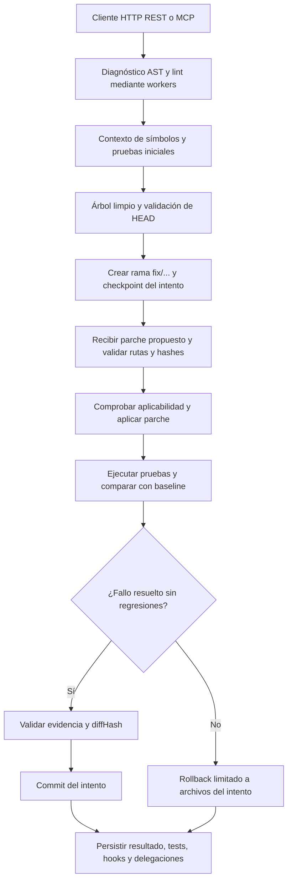

# DevGuardian — Sistema de Auditoría y Rectificación Autónoma de Código Asistido por IA

## Hooks de Backend y Base de Datos

El motor `src/hooks/` conecta guardrails reales al parcheador y al commit mediante `hookManager` opcional, con bloqueo previo a la mutación, aprobación registrada y auditoría consultable. Incluye protección de archivos/secretos, evidencia de pruebas para commits y validación de registros antes de persistir. La configuración se conserva en los logs y el adaptador de persistencia permite conectar una BD desde el backend separado del frontend.

**Defensa:** [arquitectura, configuración, eventos y ejemplos reproducibles](src/hooks/README.md). La suite `tests/hooks/hooks.test.mjs` demuestra un parche **ACEPTADO**, parches **BLOQUEADOS** sin modificar archivos ni HEAD, y escrituras de BD válidas/corruptas. Son hooks del motor, independientes de los hooks nativos de Git. La delegación a subagentes está integrada mediante `pre:delegate` y `post:delegate`.

```sh
npm run check
npm test
```

## Subagentes: «Hook + subagente»

`src/subagents/` implementa delegación real mediante **un worker independiente por tarea**, contexto acotado, whitelist por rol, presupuesto y contratos de salida validados. El coordinador delega diagnóstico AST/lint y verificación con Test Runner; consume sus reportes para aplicar un parche propuesto, hacer commit con evidencia confiable o ejecutar rollback por regresión. El rol adicional `patch-safety` permite delegar un preflight de hooks sin conceder escritura Git.

`DelegationStore` conserva quién delegó, objetivo, contexto, herramientas efectivas, identidad del worker, resultado y decisión tomada con ese resultado. Su adaptador DB conserva las trazas, disponibles mediante REST y MCP. Los especialistas son deterministas y no requieren un LLM; la generación de parches con un modelo sigue pendiente.

**Defensa:** [protocolo, aislamiento y demostración reproducible](src/subagents/README.md). Las 22 pruebas de `tests/subagents/subagents.test.mjs` incluyen commit y rollback en repositorios temporales con el analizador y Jest reales. Para producir logs visibles con configuración de hooks:

```sh
npm run build
node scripts/demo-subagents.mjs
```

La demo guarda [éxito con commit](artifacts/subagents/success.json) y [regresión con rollback](artifacts/subagents/regression.json): revisar `delegationLogs`, `consumption`, `hookLogs` y los hashes de HEAD. Cada artefacto conserva las tres delegaciones y sus cinco llamadas reales a herramientas.

[](https://github.com/LuisMI2005-sudo/ProyectoCertiIA/actions/workflows/ci.yml)

**Grupo:** Six seven  
**Integrantes:** Eduardo Quinteros, Sebhastian Campero, Luis Miguel Gonzales

DevGuardian es una plataforma para diagnosticar errores de software, generar parches en ramas de reparación y verificar sus resultados mediante pruebas antes de confirmar cambios. Su diseño utiliza **Model Context Protocol (MCP)** para conectar un agente de inteligencia artificial con herramientas locales de análisis de código, ejecución de pruebas y control de versiones, mediante entradas y respuestas estructuradas y validadas.

El ciclo autónomo previsto combina análisis AST y lint, contexto acotado para el modelo, ramas `fix/...`, comprobaciones de integridad, comparación de pruebas y commit o rollback por intento. El backend HTTP y el servidor MCP ya conectan los módulos, hooks, workers y persistencia. El flujo coordinado ejecuta diagnóstico → baseline → parche propuesto por el cliente → verificación → commit o rollback. El agente generativo conectado a un modelo y el dashboard siguen pendientes.

## 2. Estado Actual del Proyecto y Métricas de Calidad

| Fase | Módulo | Estado | Pruebas aprobadas |
|---|---|---|---:|
| Fase 1 | `src/shared/` | Completada | 30 |
| Fase 2 | `src/git-controller/` | Completada | 35 |
| Fase 3 | `src/analyzer/` | Completada | 44 |
| Fase 4 | `src/test-runner/` | Completada | 43 |
| Fase 5 + HTTP | `src/mcp/`, `src/server/` | Herramientas MCP por stdio/HTTP y REST implementadas | 28 |
| MCP de compatibilidad | `src/mcp-server/` | Integrado desde origin/main: recurso de análisis y 10 herramientas de dominio | 3 |
| Fase 6 | `src/agent/` | Pendiente | — |
| Hooks | `src/hooks/` | Implementado | 20 |
| Subagentes | `src/subagents/` | Implementado | 22 |
| Persistencia | `src/db/` | Local durable + adaptador PostgreSQL | 32 |
| **Total implementado** | **Fases 1–5 + HTTP + Hooks + Subagentes + DB** | **9 suites** | **257** |

**Validación integral del backend:**

- **257 pruebas unitarias y de integración** al instalar también pytest y `pytest-json-report`; sin pytest en el PATH, el smoke test de Python se omite localmente. En CI ambos runners son obligatorios.
- Compilación TypeScript estricta correcta y comprobación de tipos mediante `tsc -p tsconfig.json --noEmit` sin errores.
- ESLint sin errores en el código fuente.
- Integración Git comprobada con repositorios temporales reales: ramas, parches, diffs, commits verificados, concurrencia y rollback.
- Pruebas del analizador sobre símbolos, referencias, imports, diagnósticos, límites, almacenamiento y seguridad de rutas.
- Ejecutor de pruebas verificado con ejecutables Jest y pytest: estados, límites de tiempo, cancelación, huellas, comparaciones, evidencia y cierre real del ciclo analizar → parchear → ejecutar → verificar → confirmar.
- HTTP verificado con puertos efímeros, `fetch`, reparaciones reales, regresiones, hooks bloqueados y recuperación del historial al reiniciar. MCP comprobado con clientes oficiales del SDK por HTTP JSON y stdio.

Las pruebas de Git realizan commits exclusivamente dentro de sus repositorios temporales. Los fixtures con errores sintácticos, semánticos o de lint son casos deliberados de prueba, excluidos de la compilación de producción.

## 3. Arquitectura y Árbol de Directorios Actual

El sistema separa servidor MCP, API HTTP, analizador, ejecutor de pruebas, controlador Git y coordinación. `shared/` reúne contratos, errores y seguridad comunes; `db/` conserva auditorías, runs, hooks y delegaciones. Los módulos de dominio no dependen de una conexión con un modelo para ejecutar sus operaciones.

El siguiente diagrama muestra el ciclo disponible desde REST y las herramientas MCP. El parche se recibe explícitamente del cliente; su generación con un LLM corresponde al agente pendiente.



Estructura existente del proyecto; los comentarios describen el propósito de cada archivo:

```text
ProyectoCertiIA/
├── README.md                         # Identificación, arquitectura y avances
├── package.json                      # Dependencias exactas y scripts npm
├── package-lock.json                 # Resolución de dependencias reproducible
├── tsconfig.json                     # TypeScript estricto y salida en dist/
├── .gitignore                        # Exclusiones de compilación, secretos y temporales
├── .env.example                      # Configuración de BD con valores ficticios
├── scripts/
│   ├── copy-db-schema.mjs             # Incluye schema.sql en dist/ al compilar
│   └── verify-database.mjs            # Demo de escritura y recuperación tras reapertura
├── src/
│   ├── shared/
│   │   ├── errors.ts                 # Errores tipados y sobre Result<T>
│   │   ├── path-security.ts          # Validación y confinamiento de rutas
│   │   └── contracts.ts              # Interfaces y esquemas Zod compartidos
│   ├── git-controller/
│   │   ├── types.ts                  # Sesiones, intentos, checkpoints y cola
│   │   ├── repository.ts             # Operaciones Git, ramas y serialización
│   │   ├── patch-manager.ts          # Parches, hashes, diffs, commits y rollback
│   │   ├── index.ts                  # Fachada pública y siete handlers Git
│   │   └── README.md                 # Operación, evidencia y recuperación detalladas
│   ├── analyzer/
│   │   ├── types.ts                  # Snapshots, símbolos, límites y análisis guardados
│   │   ├── ast-analyzer.ts           # Lectura y análisis con TypeScript Compiler API
│   │   ├── eslint-analyzer.ts        # ESLint programático y diagnósticos normalizados
│   │   ├── index.ts                  # Tres handlers y almacenamiento por analysisId
│   │   └── README.md                 # Semántica, configuración y límites detallados
│   ├── test-runner/
│   │   ├── types.ts                  # Ejecuciones, casos, comparación y evidencia
│   │   ├── process.ts                # Ejecución de procesos con timeout y salida acotada
│   │   ├── reports.ts                # Adaptadores de reportes Jest y pytest
│   │   ├── index.ts                  # Fachada, dos handlers y VerificationStore
│   │   └── README.md                 # Ejecución, huellas, comparación y límites detallados
│   ├── hooks/                        # Registro, guardrails, coordinador y documentación
│   ├── subagents/                    # Workers, RPC, especialistas, trazas y coordinador
│   ├── mcp-server/                   # MCP de compatibilidad aportado por Eduardo, con recurso de análisis
│   ├── mcp/
│   │   ├── server.ts                 # 19 tools, SDK y transporte HTTP JSON sin sesión
│   │   └── index.ts                  # Entrada stdio y exportaciones MCP
│   ├── server/
│   │   ├── contracts.ts              # Esquemas REST, filtros y errores HTTP
│   │   ├── application.ts            # Coordinación, persistencia y runtimes MCP
│   │   ├── http.ts                   # Rutas, CORS, autenticación opcional y límites
│   │   ├── main.ts                   # Arranque HTTP y cierre ordenado
│   │   ├── index.ts                  # Fachada pública del backend
│   │   └── README.md                 # Endpoints, ejemplos curl, MCP y límites
│   └── db/
│       ├── types.ts                  # Contratos de persistencia y esquemas Zod
│       ├── repository.ts             # Integridad y transiciones comunes
│       ├── schema.sql                # Cinco tablas, constraints e índices PostgreSQL
│       ├── migrations.ts             # Migración transaccional con versión y checksum
│       ├── local-adapter.ts          # JSON durable, lock y reemplazo atómico
│       ├── postgres-adapter.ts       # Pool pg y consultas parametrizadas
│       ├── bridges.ts                # Hooks/delegaciones y AuditPersistenceService
│       ├── index.ts                  # Factory local/PostgreSQL y exportaciones
│       └── README.md                 # Modelo ER, integración y evidencia de persistencia
├── tests/
│   ├── shared.test.mjs                # 30 pruebas de seguridad y contratos
│   ├── git-controller/
│   │   └── controller.test.mjs        # 35 pruebas con repositorios Git reales
│   ├── analyzer/
│   │   └── analyzer.test.mjs          # 44 pruebas del analizador y sus recursos
│   ├── test-runner/
│   │   └── runner.test.mjs            # 43 pruebas, incluidos Jest/pytest reales
│   ├── hooks/hooks.test.mjs           # 20 pruebas de hooks y auditoría
│   ├── subagents/subagents.test.mjs   # 22 pruebas de delegación y reparación real
│   ├── db/db.test.mjs                 # 32 pruebas de persistencia y reinicio
│   ├── mcp-server/server.test.mjs     # 3 pruebas de discovery, validación y recurso MCP
│   └── server/server.test.mjs         # 28 pruebas HTTP/MCP con motores y BD reales
└── fixtures/
    ├── typescript/
    │   ├── domain.ts                 # Tipos y funciones importadas por otros casos
    │   ├── symbols.ts                # Clases, métodos, funciones y nombres sombreados
    │   ├── imports.ts                # Imports, reexports y dependencias de tipos
    │   ├── syntax-error.ts           # Error sintáctico controlado
    │   ├── semantic-error.ts         # Incompatibilidad de tipos controlada
    │   └── lint-error.ts             # Infracciones de reglas ESLint controladas
    └── runner/
        ├── fake-jest.mjs             # Ejecutable Jest falso para pruebas deterministas
        └── fake-pytest.mjs           # Ejecutable pytest falso para pruebas deterministas
```

`dist/` se genera al compilar y `node_modules/` al instalar dependencias; ambos están excluidos de Git. La Fase 5 utiliza `src/mcp/`; el agente generativo de Fase 6 continúa pendiente. El servidor de compatibilidad `src/mcp-server/` aporta el recurso `devguardian://analysis/{analysisId}`; su exposición en el servidor principal de 19 herramientas queda pendiente.

## 4. Registro Detallado de Cambios e Implementación por Fase (Changelog Técnico)

### Fase 1: Configuración Base y Módulo Transversal (`src/shared/`)

- **Entorno:** Node.js 24, ES Modules y TypeScript **6.0.3**. La configuración utiliza `NodeNext`, `strict`, `noUncheckedIndexedAccess`, `exactOptionalPropertyTypes`, comprobación de variables/parámetros sin uso y bloqueo de emisión ante errores. La compilación genera declaraciones y mapas de código.
- **Dependencias:** versiones directas exactas para MCP SDK, Zod, `simple-git`, TypeScript, ESLint, parser/plugin TypeScript, LangChain y Anthropic. Jest ejecuta las pruebas del proyecto.
- **`errors.ts`:** clases y códigos de error de dominio; sobre discriminado `Result<T>` con éxito `{ ok: true, data }` o fallo `{ ok: false, error }`; captura de excepciones y sanitización de errores internos desconocidos.
- **`path-security.ts`:** validación de rutas relativas y canónicas, prevención de *path traversal*, protección de `.git` y rechazo de objetos especiales del filesystem. Los enlaces simbólicos internos pueden leerse, pero los externos se rechazan. Las escrituras rechazan enlaces simbólicos y archivos con múltiples hard links.
- **`contracts.ts`:** interfaces y esquemas Zod estrictos para las **12 herramientas MCP previstas**, además de diagnósticos, símbolos, dependencias, resultados de procesos/pruebas y evidencia de verificación. Los contratos de `run_tests` y `compare_test_runs` existen, pero sus implementaciones corresponden a la Fase 4.
- **Verificación:** 30 pruebas aprobadas de contratos, errores, límites y seguridad de rutas.

### Fase 2: Controlador de Versiones y Parches (`src/git-controller/`)

- **`types.ts`:** representación interna de sesiones `sessionId`, intentos `attemptId`, huellas de archivos, checkpoints e información de serialización.
- **`repository.ts`:** integración con `simple-git`; exigencia de árbol limpio y coincidencia de `expectedHead` antes de crear una rama `fix/...`; registro del commit y del estado de archivos/índice al iniciar un intento.
- **Serialización:** cola FIFO compartida por instancias que operan sobre el mismo checkout canónico y lock exclusivo en el directorio común de Git para coordinar procesos cooperantes. Los comandos tienen timeout y salida acotada. Los hooks del repositorio y fsmonitor están deshabilitados para las operaciones del controlador.
- **`patch-manager.ts`:** comprobación exacta del conjunto de `expectedFileHashes`, hashes SHA-256 y rutas antes de aplicar cambios; validación con `git apply --check` e índices temporales que preservan el staging real. Un hash esperado `null` exige que el archivo no exista.
- **Diffs y commits:** cálculo del diff completo del intento, `diffHash`, archivos afectados e inserciones/eliminaciones. El commit exige `expectedDiffHash` y evidencia confiable asociada a `verificationRunId`: baseline y candidato completos, configuración comparable, fallos resueltos, ausencia de regresiones y huellas compatibles con el checkpoint y el workspace actual.
- **Confirmación:** creación del commit con índice privado, bloqueo nativo del índice y actualización condicional de la referencia mediante `update-ref` con el HEAD anterior esperado. Hay compensación ante fallos controlados de instalación del índice.
- **Rollback quirúrgico:** aplicación del diff inverso del intento en la misma rama `fix/...`, con HEAD y archivos verificados. Conserva archivos y staging ajenos, recrea padres necesarios de forma validada y rechaza sobrescribir cambios externos en archivos gestionados. No revierte intentos ya confirmados ni ejecuta un reset global.
- **`index.ts`:** fachada de dominio y siete handlers Git con sobre `Result<T>`. La evidencia se obtiene del `VerificationStore` confiable inyectado por el Test Runner, integrado desde la Fase 4.
- **Verificación:** 35 pruebas aprobadas sobre repositorios temporales reales.

El bloqueo coordina escritores que respetan el protocolo; no impide modificaciones de editores o procesos externos que lo ignoren. Las sesiones se conservan en memoria y los locks abandonados tras una interrupción requieren revisión manual. Detalles de operación y recuperación: [documentación técnica de Git Controller](src/git-controller/README.md).

### Fase 3: Motor de Análisis Estático y AST (`src/analyzer/`)

- **`types.ts`:** snapshots de fuente, nodos y tabla de símbolos, resultados AST, metadatos de análisis y opciones de límites de recursos.
- **`ast-analyzer.ts` — lectura:** `read_file_context` devuelve intervalos inclusivos de líneas, preserva UTF-8/BOM y saltos de línea, calcula SHA-256 del archivo completo y señala recortes con `truncated`. La lectura de contexto calcula posiciones sin necesitar un parseo AST.
- **`ast-analyzer.ts` — símbolos:** `get_symbol_context` selecciona el símbolo envolvente más específico y extrae nombre, firma, rango, fuente exacta del nodo, imports y referencias locales. El Type Checker distingue identidades de símbolos y evita confundir nombres sombreados. Las líneas/columnas empiezan en 1 y el extremo final de los rangos es exclusivo.
- **`ast-analyzer.ts` — diagnóstico:** `analyze_code` utiliza TypeScript Compiler API para diagnósticos sintácticos y semánticos, símbolos afectados y dependencias directas. Reconoce imports de tipos, reexports, imports dinámicos y llamadas `require` con argumento literal, además de aliases y condiciones de resolución NodeNext ESM/CommonJS.
- **Confinamiento:** el CompilerHost restringe lecturas al workspace y a las declaraciones estándar de TypeScript instaladas; no ejecuta las dependencias analizadas ni emite archivos. Cada solicitud crea un Program nuevo para evitar reutilizar información semántica obsoleta.
- **`eslint-analyzer.ts`:** integración con la clase `ESLint`, Flat Config y `lintText` sobre el mismo snapshot del AST. Normaliza regla, severidad, mensaje y ubicación, incluidos errores fatales de parseo. No aplica fixes ni carga configuración JavaScript del workspace por defecto; los overrides son configuración confiable de inicialización.
- **`index.ts`:** tres handlers MCP con `Result<T>` y almacenamiento en memoria por `analysisId`, con límites de capacidad y bytes, expulsión LRU y TTL fijo. `getAnalysis` y `getAnalysisMetadata` devuelven copias defensivas para el futuro recurso `devguardian://analysis/{analysisId}`.
- **Verificación:** 44 pruebas aprobadas y seis fixtures TypeScript controlados.

El analizador aplica límites de archivos, programa, nodos AST, texto, diagnósticos y referencias. Su ejecución es en proceso: estos límites no constituyen un timeout estricto de CPU ni un sandbox del sistema operativo. Detalles de configuración y semántica: [documentación técnica del analizador](src/analyzer/README.md).

### Fase 4: Ejecutor de Pruebas y Verificación (`src/test-runner/`)

- **`types.ts`:** opciones del ejecutor, configuración confiable de runners (Jest/pytest), ejecuciones, casos de prueba, resultados de comparación y evidencia de verificación.
- **`process.ts`:** ejecución sin shell con lista blanca de variables de entorno, cwd fija en el workspace, timeout por proceso, cancelación explícita y terminación del árbol de procesos (grupo de proceso en POSIX, `taskkill` en Windows). stdout y stderr se capturan por separado con presupuesto `min(maxOutputBytes, 100000)` bytes por flujo y marca `truncated`; un fallo de arranque no produce código de salida.
- **`reports.ts`:** adaptadores de reporte para Jest (`--json --outputFile=`) y pytest (`--json-report --json-report-file=`), que el módulo agrega a la línea de comandos por sí mismo. Las rutas de suite se normalizan a rutas relativas POSIX del workspace; rutas fuera del workspace, inválidas o identificadores duplicados rechazan el reporte.
- **Estados:** `passed` solo para una ejecución completa con código 0, al menos un test aprobado y ningún fallo; `failed` para el resto; `timeout`, `cancelled` o `error` para ejecuciones terminadas, canceladas o sin reporte válido. `complete: false` indica que el resultado no sirve como evidencia.
- **`index.ts`:** fachada con `run_tests` y `compare_test_runs` sobre `Result<T>`, ejecuciones serializadas por instancia, y almacenamiento en memoria de ejecuciones y evidencia con límites de entradas, bytes y TTL. La misma instancia actúa como `VerificationStore` confiable que inyecta `git_commit_fix`.
- **Huellas:** `workspaceStateHash` se captura del proveedor confiable justo antes de la ejecución; `configurationHash` es SHA-256 de la configuración confiable resuelta del runner. Solo se comparan ejecuciones completas con el mismo hash de configuración.
- **Integridad de reportes:** Jest exige numTotalTests igual al número de casos; pytest contrasta total y collected menos deselected. Los reportes parciales y errores de suite/colección no sirven como evidencia.
- **Comparación y ciclo completo:** `compareTestRuns` informa fallos resueltos, fallos nuevos, tests ausentes y veredicto (`regression`, `success`, `inconclusive`). `verify(baselineRunId, candidateRunId)` registra `VerificationEvidence` por `candidateRunId`, lo que permite cerrar el ciclo real analizar → parchear → ejecutar → verificar → confirmar con `git_commit_fix`.
- **Verificación:** 43 pruebas: 41 casos con ejecutables controlados y repositorios temporales, más dos smoke tests que invocan Jest real y pytest real y validan sus reportes JSON mediante el Test Runner. El caso de integración Git utiliza un ejecutor simulado; los smoke tests verifican los adaptadores con procesos reales.

El ejecutor no es un sandbox del sistema operativo: los tests son código arbitrario que se ejecuta con el entorno permitido y conviene correrlos en un checkout dedicado. pytest requiere el plugin `pytest-json-report`. Detalles de ejecución, huellas y límites: [documentación técnica del Test Runner](src/test-runner/README.md).

### Fase 5: API HTTP y Servidor MCP (`src/server/`, `src/mcp/`)

- **REST nativo:** salud, proyectos, ejecución y consulta de auditorías, configuración/logs/evaluación de hooks y trazas de subagentes. CORS configurable, errores tipados, logs sin cuerpos ni credenciales, límites de peticiones y autenticación bearer opcional.
- **Flujo completo:** `POST /api/audits/run` conecta el coordinador real con persistencia; conserva baseline/candidato, hallazgos, checkpoint, decisiones de hooks y delegaciones. La suite comprueba commit, rollback, bloqueo y recuperación tras reiniciar.
- **MCP:** SDK oficial, negociación y descubrimiento de 19 herramientas, esquemas Zod y auditoría durable de llamadas. Transporte stdio y HTTP JSON sin sesión, con clientes oficiales; no incluye SSE ni reanudación de eventos.
- **Compatibilidad estricta:** la biblioteca `DOM` aporta los tipos web que utiliza el SDK; se mantienen `strict`, `exactOptionalPropertyTypes` y `skipLibCheck: false`.
- **Verificación:** 28 pruebas adicionales; 257 en total y nueve suites.

## 5. Contratos de Herramientas MCP Implementadas

Las siguientes **12 herramientas de dominio están publicadas mediante MCP**, con un `projectId` UUID adicional obligatorio en cada llamada. El servidor añade el alias `git_rollback` y seis consultas de hooks, subagentes y BD: **19 herramientas** en total. `tools/list` devuelve los esquemas efectivos.

Todas las salidas exitosas de la tabla corresponden a `data` dentro de `Result<T>`. Los fallos usan `{ ok: false, error: { code, message, retryable, details? } }`. `?` indica un parámetro opcional; los IDs son UUID, las huellas de archivo/diff son SHA-256 hexadecimales y todas las rutas de herramientas son relativas al workspace configurado.

| Herramienta | Entradas | Salida exitosa (`data`) | Garantías y condiciones de seguridad |
|---|---|---|---|
| `read_file_context` | `path: string`, `startLine?: number`, `endLine?: number` | `{ path, content, startLine, endLine, fileHash, truncated }` | Ruta validada, archivo regular UTF-8, lectura acotada y hash del archivo completo; rechaza lecturas fuera del workspace. |
| `analyze_code` | `paths: string[]`, `checks: Array<"syntax" \| "semantic" \| "lint">` | `{ analysisId, diagnostics, affectedSymbols, dependencies, analyzedFiles, truncated }` | Esquemas estrictos, sin rutas/identidades duplicadas, CompilerHost restringido y límites de recursos; no modifica ni ejecuta el código objetivo. |
| `get_symbol_context` | `path: string`, `line: number` | `{ symbol, signature, range, source, imports, references, fileHash, truncated }` | Símbolo más específico, referencias por identidad del checker y contexto acotado; errores explícitos para líneas inválidas o sin símbolo compatible. |
| `git_status` | `{}` | `{ branch, headCommit, clean, staged, modified, untracked, conflicted }` | Consulta serializada; informa HEAD separado o repositorio sin commit mediante campos nulos cuando corresponde; no modifica archivos del usuario. |
| `git_create_fix_branch` | `slug: string`, `expectedHead: string` | `{ sessionId, branch, baseBranch, baseCommit }` | Exige árbol limpio, rama adjunta, HEAD esperado y nombre validado; crea `fix/...` sin sobrescribir ramas existentes. |
| `git_begin_attempt` | `sessionId: string` | `{ attemptId, checkpointCommit }` | Valida sesión y rama, exige árbol limpio y un único intento activo por sesión; registra checkpoint y huellas. |
| `git_apply_patch` | `sessionId: string`, `attemptId: string`, `unifiedDiff: string`, `expectedFileHashes: Record<string, string \| null>` | `{ applied: true, changedFiles, diffHash }` | Verifica rutas y hashes exactos, estado del intento y aplicabilidad antes de escribir; admite parches de texto y rechaza binarios, symlinks y modos especiales. Preserva el staging real. |
| `git_diff` | `sessionId: string`, `attemptId: string` | `{ diff, diffHash, changedFiles, insertions, deletions }` | Diff acotado del intento contra su checkpoint; incluye altas y bajas mediante un índice temporal y detecta modificaciones externas en archivos gestionados. |
| `git_commit_fix` | `sessionId: string`, `attemptId: string`, `message: string`, `expectedDiffHash: string`, `verificationRunId: string` | `{ commit, branch, files }` | Exige parche no vacío, diff esperado, evidencia vigente y estado compatible; usa locks de índice y actualización condicional del HEAD. No confirma trabajo ajeno. |
| `git_rollback_attempt` | `sessionId: string`, `attemptId: string` | `{ restoredCommit, revertedFiles, branch, clean }` | Revierte solo cambios del intento activo con rama/HEAD intactos; conserva trabajo externo y rechaza conflictos de propiedad. `clean` puede ser `false` si queda trabajo ajeno. |
| `run_tests` | `runner: "jest" \| "pytest"`, `targets?: string[]`, `timeoutMs?: number` | `{ runId, runner, status, exitCode, durationMs, summary, cases, stdout, stderr, truncated, complete, startedAt, finishedAt, workspaceStateHash, configurationHash }` | Runners confiables, timeout y salida limitados, rutas confinadas. Solo reportes con totales coherentes pueden ser completos. |
| `compare_test_runs` | `baselineRunId: string`, `candidateRunId: string` | `{ resolvedFailures, newFailures, missingTests, comparable, verdict }` | Compara runs completos y configuraciones idénticas. `newFailures` incluye pruebas antes aprobadas que pasan a skipped/todo; estas transiciones producen `regression`, nunca `success`. |

Los esquemas y tipos completos están definidos en [`src/shared/contracts.ts`](src/shared/contracts.ts). Los métodos de dominio retornan datos tipados y lanzan errores de dominio; las fachadas `.tools` los convierten al sobre `Result<T>`, expuesto en `structuredContent` y texto por MCP. Las raíces, límites y proveedores de evidencia se configuran al inicializar los servicios y no son argumentos elegibles por el modelo. Las seis consultas y el alias están documentados en [el servidor](src/server/README.md#mcp-herramientas-y-transportes).

## 6. Requisitos, Instalación y Comandos de Verificación

Requisitos actuales:

- **Node.js 24.x**, conforme a `engines.node: >=24.0.0 <25`.
- **npm**, disponible con Node.js.
- **Git** accesible mediante `PATH`. Las pruebas Git configuran identidad local en sus fixtures; para commits de reparación sobre otro repositorio debe existir una identidad Git válida allí.
- Permisos de lectura/escritura en el workspace y soporte de enlaces de directorio para ejecutar las pruebas de seguridad; en Windows se utilizan junctions.

Desde PowerShell, ubicar la terminal en la raíz del proyecto:

```powershell
Set-Location 'C:\Users\HP\ProyectocertiIA\ProyectoCertiIA'
```

Instalar las dependencias:

```sh
npm install
```

El repositorio incluye `package-lock.json`; `npm ci` es la alternativa para instalaciones reproducibles desde ese archivo.

Comandos de compilación y verificación:

| Objetivo | Comando exacto | Resultado esperado |
|---|---|---|
| Compilar | `npm run build` | JavaScript ESM, declaraciones y mapas en `dist/`. |
| Verificar tipos sin emitir | `npm run typecheck` | `tsc -p tsconfig.json --noEmit` sin errores. |
| Verificar estilo y reglas | `npm run lint` | ESLint sin errores en `src/`. |
| Verificar tipos y lint juntos | `npm run check` | Ejecución secuencial de ambas comprobaciones. |
| Ejecutar la suite completa | `npm test` | Compilación previa y 257 pruebas en nueve suites Jest; el smoke test de pytest requiere Python y su plugin JSON. |
| Iniciar HTTP compilado | `npm start` | Backend en `http://127.0.0.1:3001` por defecto. |
| Compilar e iniciar HTTP | `npm run dev:server` | Compilación inicial y servidor HTTP; reiniciar para incorporar cambios. |
| Iniciar MCP stdio compilado | `node dist/mcp/index.js` | Transporte stdio con stdout reservado al protocolo. |

Para reproducir la validación completa:

```sh
npm run typecheck
npm run lint
npm run build
npm test
```

`npm test` compila de nuevo antes de ejecutar Jest y utiliza el soporte ESM de Node mediante `--experimental-vm-modules`. Esto puede mostrar un aviso de característica experimental sin implicar un fallo de las pruebas. Su timeout base es de 10 segundos por prueba; las suites de integración ajustan sus tiempos para los escenarios correspondientes.

Los scripts `start`, `start:server`, `dev:server` y `start:mcp` ya son funcionales. `start:agent` continúa reservado para la fase generativa pendiente. La validación no requiere una clave de Anthropic. Además de los ejecutables controlados de `fixtures/runner/`, la suite incluye smoke tests con Jest y pytest reales y reparaciones HTTP con Jest real. pytest debe estar en el PATH junto con el plugin `pytest-json-report`; si el binario existe pero falta el plugin, la prueba falla.

## API HTTP REST y MCP

El backend admite `PORT` (3001 por defecto), `HOST`, CORS mediante `ALLOWED_ORIGIN` o `CORS_ORIGIN`, raíz de workspace confiable y token bearer opcional. La configuración se pasa al entorno del proceso; Node no carga `.env` automáticamente. Para una copia local del ejemplo: `node --env-file=.env dist/server/main.js` después de compilar.

| Rutas | Función |
|---|---|
| GET `/health`, GET `/api/health` | BD conectada, modo local/PostgreSQL, cinco tablas, versión, uptime y runners. |
| GET/POST `/api/projects` | Consultar y registrar raíces Git permitidas. |
| GET `/api/audits`, GET `/api/audits/:id`, POST `/api/audits/run` | Historial durable y ejecución real del coordinador en modo diagnóstico o reparación con parche explícito. |
| GET `/api/hooks/logs`, GET `/api/hooks/config`, POST `/api/hooks/evaluate` | Decisiones persistidas y demostración de bloqueo sin modificar archivos. |
| GET `/api/subagents/delegations` | Trazas de herramientas, resultados y consumo de cada delegación. |
| POST `/api/mcp` | JSON-RPC MCP: inicialización, `tools/list` y `tools/call`. |

```sh
npm run dev:server
```

Desde otra terminal:

```sh
curl http://127.0.0.1:3001/api/health
curl http://127.0.0.1:3001/api/projects
curl -H "Content-Type: application/json" -d '{"jsonrpc":"2.0","id":1,"method":"tools/list","params":{}}' http://127.0.0.1:3001/api/mcp
```

Ejemplos completos de registro, diagnóstico, reparación, hooks bloqueados y llamadas MCP: [documentación de la API](src/server/README.md). En PowerShell usar `curl.exe` o `Invoke-RestMethod`. El historial se recupera después de reiniciar; las sesiones Git activas y análisis por ID continúan en memoria. El estado DB `blocked` se usa también para diagnósticos y herramientas aisladas que no autorizan una reparación completa; `summaryJson.mode` y `outcome` distinguen estos casos.

## Integración Continua (CI)

El workflow [CI](https://github.com/LuisMI2005-sudo/ProyectoCertiIA/actions/workflows/ci.yml), definido en [`.github/workflows/ci.yml`](.github/workflows/ci.yml), se ejecuta con cada push a `main` o `Dev` y cada pull request dirigido a esas ramas. Utiliza Ubuntu, Node.js 24.x, caché de npm y Python 3.11. Instala Node con `npm ci` y versiones fijadas de pytest y `pytest-json-report`, configura una identidad Git para los repositorios temporales y ejecuta:

1. `npm run check`: TypeScript estricto sin emitir y ESLint.
2. `npm test`: compilación y las nueve suites, incluidos los smoke tests con Jest y pytest reales, los flujos delegados de commit/rollback, la persistencia con reinicio real de Node y el backend HTTP/MCP. Los smoke tests invocan `TestRunner`, procesan el JSON real con `reports.ts` y exigen `complete: true`, `status: passed`, código de salida 0 y un caso aprobado.
3. Una tabla de resultados en el resumen de Actions, que también informa fallos o pasos no ejecutados.

El workflow solo dispone de `contents: read`, cancela ejecuciones anteriores de la misma rama y tiene un límite de 15 minutos. No incluye despliegues ni requiere secretos o archivos `.env`. `DEVGUARDIAN_REQUIRE_PYTEST=1` hace fallar la suite si falta pytest en CI.

Para reproducirlo localmente, con Node.js 24.x, Git y Python 3.11 o superior:

```sh
npm ci
python -m venv .venv-ci
```

Activar el entorno virtual con `source .venv-ci/bin/activate` en Bash o `.\.venv-ci\Scripts\Activate.ps1` en PowerShell. Después:

```sh
python -m pip install pytest==8.4.2 pytest-json-report==1.5.0
npm run check
npm test
```

Para exigir pytest también localmente, usar `DEVGUARDIAN_REQUIRE_PYTEST=1 npm test` en Bash o `$env:DEVGUARDIAN_REQUIRE_PYTEST = '1'; npm test` en PowerShell.

Para la defensa, abrir **Actions → CI → Run workflow**, seleccionar `Dev` y ejecutar manualmente. GitHub habilita este botón cuando el workflow está presente en la rama predeterminada; si esta es `main`, primero debe integrarse allí el archivo mediante el flujo habitual de revisión. Mientras solo exista en `Dev`, un push a `Dev` activa automáticamente la validación.

## Base de Datos y Persistencia

`src/db/` implementa cinco tablas de dominio: proyectos, auditorías, ejecuciones de pruebas, decisiones de hooks y delegaciones. Los hallazgos y checkpoints de intentos se conservan en el resumen de la auditoría. Los adaptadores reales `HookPersistenceAdapter` y `DelegationPersistenceAdapter` escriben en el repositorio común; `AuditPersistenceService.repairProject()` conecta el coordinador con ese almacenamiento y guarda baseline, candidato, commit o rollback.

Sin `DATABASE_URL` se utiliza un JSON durable en `./data/devguardian-db.json`, con bloqueo entre procesos y reemplazo atómico. Con `DATABASE_URL` y modo distinto de `local`, la factory usa PostgreSQL con `pg`, consultas parametrizadas, transacciones y migraciones versionadas. `DEVGUARDIAN_DB_MODE=local` permite forzar el modo de desarrollo; para cloud debe cambiarse a `postgres` o eliminarse. Las variables de ejemplo están en [`.env.example`](.env.example), sin credenciales reales; `.env` y los archivos locales documentados están ignorados por Git.

```sh
npm run db:verify
```

El comando crea datos de demostración, cierra y reabre la conexión y muestra sus IDs y recuperación. Se pueden consultar desde otro proceso con `npm run db:verify -- UUID_DE_LA_AUDITORIA`. Las pruebas de DB comprueban además una reparación real con Jest, auditorías de hooks y delegaciones que permanecen intactas al arrancar otro proceso Node.

**Estado de entrega:** la persistencia local es funcional y el adaptador PostgreSQL fue comprobado también contra un servidor real temporal, con migraciones, operaciones sobre las cinco tablas y recuperación tras reabrir la conexión. Esto no acredita todavía una BD cloud desplegada: falta aprovisionar el proveedor, configurar `DATABASE_URL` como secreto y demostrar escritura/lectura tras reinicio en ese entorno. El CI usa almacenamiento local y cliente PostgreSQL mockeado, sin requerir servidor externo ni secretos. La API REST/MCP ya permite consultar el historial; el dashboard frontend y los despliegues externos siguen pendientes.

Modelo entidad-relación, límites, seguridad, integración y pasos para Render/Supabase/Neon: [documentación de persistencia](src/db/README.md).

## Consolidación de ramas y regresiones

Se integró origin/main en Dev mediante merge conservando hashes y autoría: MCP de compatibilidad, corrección de rutas Git antes de evaluar árbol sucio, aserciones CRLF exactas y validación CI en QA. El workflow conserva Node/Python, los smoke tests reales y ejecución manual. Las ocho suites originales suman 254 pruebas tras 18 regresiones nuevas del Test Runner; la suite MCP recibida añade tres: 257 casos en nueve suites. El servidor principal sigue siendo src/mcp/ (19 herramientas auditadas y API HTTP); [src/mcp-server/](src/mcp-server/README.md) conserva la interfaz de workspace fijo y el recurso de análisis aportados desde main. El cliente generativo en otras ramas remotas no se incorporó en este merge.
