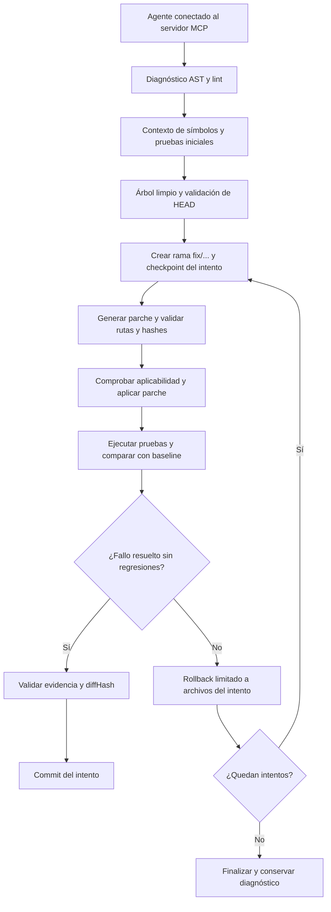

# DevGuardian — Sistema de Auditoría y Rectificación Autónoma de Código Asistido por IA

**Grupo:** Six seven  
**Integrantes:** Eduardo Quinteros, Sebhastian Campero, Luis Miguel Gonzales

DevGuardian es una plataforma para diagnosticar errores de software, generar parches en ramas de reparación y verificar sus resultados mediante pruebas antes de confirmar cambios. Su diseño utiliza **Model Context Protocol (MCP)** para conectar un agente de inteligencia artificial con herramientas locales de análisis de código, ejecución de pruebas y control de versiones, mediante entradas y respuestas estructuradas y validadas.

El ciclo autónomo combina análisis AST y lint, contexto acotado para el modelo, ramas `fix/...`, comprobaciones de integridad y commit o rollback por intento. El transporte MCP y el agente están implementados. La Fase 4 sigue pendiente en `main`, por lo que el CLI del agente verifica las herramientas necesarias y se detiene sin mutar el repositorio hasta que un servidor MCP publique las doce.

## 2. Estado Actual del Proyecto y Métricas de Calidad

| Fase | Módulo | Estado | Pruebas aprobadas |
|---|---|---|---:|
| Fase 1 | `src/shared/` | Completada | 30 |
| Fase 2 | `src/git-controller/` | Completada | 35 |
| Fase 3 | `src/analyzer/` | Completada | 44 |
| Fase 4 | `src/test-runner/` | Pendiente | — |
| Fase 5 | `src/mcp-server/` | Completada | 3 |
| Fase 6 | `src/agent/` | Implementada; espera Fase 4 para ciclo completo | 14 |
| **Total implementado** | **Fases 1–3 y 5–6** | **8 suites verificadas** | **126** |

**Validación integral, tras las Fases 5 y 6:**

- **126 pruebas unitarias y de integración en verde, con 0 fallos.**
- Compilación TypeScript estricta correcta y comprobación de tipos mediante `tsc -p tsconfig.json --noEmit` sin errores.
- ESLint sin errores en el código fuente.
- Integración Git comprobada con repositorios temporales reales: ramas, parches, diffs, commits verificados, concurrencia y rollback.
- Pruebas del analizador sobre símbolos, referencias, imports, diagnósticos, límites, almacenamiento y seguridad de rutas.

Las pruebas de Git realizan commits exclusivamente dentro de sus repositorios temporales. Los fixtures con errores sintácticos, semánticos o de lint son casos deliberados de prueba, excluidos de la compilación de producción.

## 3. Arquitectura y Árbol de Directorios Actual

El sistema separa responsabilidades entre servidor MCP, analizador, ejecutor de pruebas, controlador Git y agente. `shared/` reúne contratos, errores y seguridad comunes. El agente acepta planificadores intercambiables; las pruebas del flujo no dependen de una conexión a Anthropic.

El siguiente diagrama representa el **flujo objetivo**; los pasos de ejecución/comparación de pruebas, transporte MCP y orquestación del agente requieren las fases pendientes.



Estructura existente del proyecto; los comentarios describen el propósito de cada archivo:

```text
ProyectoCertiIA/
├── README.md
├── package.json                      # Dependencias y scripts npm
├── package-lock.json                 # Instalación reproducible
├── .env.example                      # Variables documentadas; sin secretos reales
├── .github/workflows/ci.yml          # Quality gates de Node 24
├── src/
│   ├── shared/
│   │   ├── errors.ts                 # Errores tipados y Result<T>
│   │   ├── path-security.ts          # Confinamiento de rutas
│   │   └── contracts.ts              # Contratos Zod compartidos
│   ├── git-controller/
│   │   ├── repository.ts             # Ramas, checkpoints y locks Git
│   │   ├── patch-manager.ts          # Parches, hashes, commits y rollback
│   │   └── index.ts                  # Siete herramientas Git
│   ├── analyzer/
│   │   ├── ast-analyzer.ts           # TypeScript Compiler API
│   │   ├── eslint-analyzer.ts        # Diagnósticos ESLint normalizados
│   │   └── index.ts                  # Tres herramientas y caché de análisis
│   ├── mcp-server/
│   │   └── index.ts                  # Transporte stdio, diez herramientas y recurso
│   └── agent/
│       ├── cli.ts                    # Preflight MCP y composición del agente
│       ├── index.ts                  # Orquestación segura de reparaciones
│       ├── mcp-tool-client.ts        # Adaptador tipado SDK MCP
│       ├── anthropic-planner.ts      # Planificador estructurado
│       └── types.ts                  # Contratos de solicitud y plan
├── tests/
│   ├── shared.test.mjs
│   ├── git-controller/controller.test.mjs
│   ├── analyzer/analyzer.test.mjs
│   ├── mcp-server/server.test.mjs
│   └── agent/                        # 14 pruebas deterministas, sin llamadas API
└── fixtures/typescript/              # Casos de análisis controlados
```

Documentación operativa adicional: [`src/git-controller/README.md`](src/git-controller/README.md), [`src/analyzer/README.md`](src/analyzer/README.md), [`src/mcp-server/README.md`](src/mcp-server/README.md) y [`src/agent/README.md`](src/agent/README.md).

`dist/` se genera al compilar y `node_modules/` al instalar dependencias; ambos están excluidos de Git. La Fase 4 sigue pendiente en esta línea de `main`.

## 4. Registro Detallado de Cambios e Implementación por Fase (Changelog Técnico)

### Fase 1: Configuración Base y Módulo Transversal (`src/shared/`)

- **Entorno:** Node.js 24, ES Modules y TypeScript **6.0.3**. La configuración utiliza `NodeNext`, `strict`, `noUncheckedIndexedAccess`, `exactOptionalPropertyTypes`, comprobación de variables/parámetros sin uso y bloqueo de emisión ante errores. La compilación genera declaraciones y mapas de código.
- **Dependencias:** versiones directas exactas para MCP SDK, Zod, `simple-git`, TypeScript, ESLint, parser/plugin TypeScript, LangChain y Anthropic. Jest ejecuta las pruebas del proyecto.
- **`errors.ts`:** clases y códigos de error de dominio; sobre discriminado `Result<T>` con éxito `{ ok: true, data }` o fallo `{ ok: false, error }`; captura de excepciones y sanitización de errores internos desconocidos.
- **`path-security.ts`:** validación de rutas relativas y canónicas, prevención de *path traversal*, protección de `.git` y rechazo de objetos especiales del filesystem. Los enlaces simbólicos internos pueden leerse, pero los externos se rechazan. Las escrituras rechazan enlaces simbólicos y archivos con múltiples hard links.
- **`contracts.ts`:** interfaces y esquemas Zod estrictos para las **12 herramientas MCP previstas**, además de diagnósticos, símbolos, dependencias, resultados de procesos/pruebas y evidencia de verificación. Los contratos de `run_tests` y `compare_test_runs` existen, pero sus implementaciones corresponden a la Fase 4.
- **Verificación:** 30 pruebas aprobadas de contratos, errores, límites y seguridad de rutas.

### Fase 2: Controlador de Versiones y Parches (`src/git-controller/`)

- **`types.ts`:** representación interna de sesiones `sessionId`, intentos `attemptId`, huellas de archivos, checkpoints e información de serialización.
- **`repository.ts`:** integración con `simple-git`; exigencia de árbol limpio y coincidencia de `expectedHead` antes de crear una rama `fix/...`; registro del commit y del estado de archivos/índice al iniciar un intento.
- **Serialización:** cola FIFO compartida por instancias que operan sobre el mismo checkout canónico y lock exclusivo en el directorio común de Git para coordinar procesos cooperantes. Los comandos tienen timeout y salida acotada. Los hooks del repositorio y fsmonitor están deshabilitados para las operaciones del controlador.
- **`patch-manager.ts`:** comprobación exacta del conjunto de `expectedFileHashes`, hashes SHA-256 y rutas antes de aplicar cambios; validación con `git apply --check` e índices temporales que preservan el staging real. Un hash esperado `null` exige que el archivo no exista.
- **Diffs y commits:** cálculo del diff completo del intento, `diffHash`, archivos afectados e inserciones/eliminaciones. El commit exige `expectedDiffHash` y evidencia confiable asociada a `verificationRunId`: baseline y candidato completos, configuración comparable, fallos resueltos, ausencia de regresiones y huellas compatibles con el checkpoint y el workspace actual.
- **Confirmación:** creación del commit con índice privado, bloqueo nativo del índice y actualización condicional de la referencia mediante `update-ref` con el HEAD anterior esperado. Hay compensación ante fallos controlados de instalación del índice.
- **Rollback quirúrgico:** aplicación del diff inverso del intento en la misma rama `fix/...`, con HEAD y archivos verificados. Conserva archivos y staging ajenos, recrea padres necesarios de forma validada y rechaza sobrescribir cambios externos en archivos gestionados. No revierte intentos ya confirmados ni ejecuta un reset global.
- **`index.ts`:** fachada de dominio y siete handlers Git con sobre `Result<T>`. La evidencia se obtiene de un `VerificationStore` confiable inyectado; la integración con un ejecutor real queda pendiente de la Fase 4.
- **Verificación:** 35 pruebas aprobadas sobre repositorios temporales reales.

El bloqueo coordina escritores que respetan el protocolo; no impide modificaciones de editores o procesos externos que lo ignoren. Las sesiones se conservan en memoria y los locks abandonados tras una interrupción requieren revisión manual. Detalles de operación y recuperación: [documentación técnica de Git Controller](src/git-controller/README.md).

### Fase 3: Motor de Análisis Estático y AST (`src/analyzer/`)

- **`types.ts`:** snapshots de fuente, nodos y tabla de símbolos, resultados AST, metadatos de análisis y opciones de límites de recursos.
- **`ast-analyzer.ts` — lectura:** `read_file_context` devuelve intervalos inclusivos de líneas, preserva UTF-8/BOM y saltos de línea, calcula SHA-256 del archivo completo y señala recortes con `truncated`. La lectura de contexto calcula posiciones sin necesitar un parseo AST.
- **`ast-analyzer.ts` — símbolos:** `get_symbol_context` selecciona el símbolo envolvente más específico y extrae nombre, firma, rango, fuente exacta del nodo, imports y referencias locales. El Type Checker distingue identidades de símbolos y evita confundir nombres sombreados. Las líneas/columnas empiezan en 1 y el extremo final de los rangos es exclusivo.
- **`ast-analyzer.ts` — diagnóstico:** `analyze_code` utiliza TypeScript Compiler API para diagnósticos sintácticos y semánticos, símbolos afectados y dependencias directas. Reconoce imports de tipos, reexports, imports dinámicos y llamadas `require` con argumento literal, además de aliases y condiciones de resolución NodeNext ESM/CommonJS.
- **Confinamiento:** el CompilerHost restringe lecturas al workspace y a las declaraciones estándar de TypeScript instaladas; no ejecuta las dependencias analizadas ni emite archivos. Cada solicitud crea un Program nuevo para evitar reutilizar información semántica obsoleta.
- **`eslint-analyzer.ts`:** integración con la clase `ESLint`, Flat Config y `lintText` sobre el mismo snapshot del AST. Normaliza regla, severidad, mensaje y ubicación, incluidos errores fatales de parseo. No aplica fixes ni carga configuración JavaScript del workspace por defecto; los overrides son configuración confiable de inicialización.
- **`index.ts`:** tres handlers MCP con `Result<T>` y almacenamiento en memoria por `analysisId`, con límites de capacidad y bytes, expulsión LRU y TTL fijo. `getAnalysis` y `getAnalysisMetadata` devuelven copias defensivas para el futuro recurso `devguardian://analysis/{analysisId}`.
- **Verificación:** 44 pruebas aprobadas y seis fixtures TypeScript controlados.

El analizador aplica límites de archivos, programa, nodos AST, texto, diagnósticos y referencias. Su ejecución es en proceso: estos límites no constituyen un timeout estricto de CPU ni un sandbox del sistema operativo. Detalles de configuración y semántica: [documentación técnica del analizador](src/analyzer/README.md).

### Fase 5: Servidor Model Context Protocol (`src/mcp-server/`)

- Publica mediante stdio las diez herramientas disponibles del analizador y controlador Git, con contratos Zod y respuestas `Result<T>` serializadas para clientes MCP.
- Expone `devguardian://analysis/{analysisId}` para recuperar análisis almacenados sin enumerar datos ni rutas absolutas.
- `run_tests` y `compare_test_runs` quedan fuera hasta la Fase 4; por seguridad, `git_commit_fix` no confirma reparaciones sin evidencia real de pruebas.
- Tres pruebas MCP cliente-servidor validan descubrimiento, validación, análisis y recursos. Detalles: [documentación del servidor MCP](src/mcp-server/README.md).

### Fase 6: Agente de reparación autónoma (`src/agent/`)

- **Orquestación:** comprueba checkout limpio; ejecuta baseline antes de abrir rama; valida que el repositorio no cambió durante ella; analiza, solicita plan, aplica parche, compara pruebas y confirma solo con evidencia aprobada.
- **Aislamiento:** el planificador no ejecuta herramientas ni escribe archivos. Todos los cambios pasan por contratos MCP, validación de hashes, controlador Git y `VerificationStore`.
- **Anthropic:** salida estructurada restringida, temperatura cero, contexto acotado y API key fuera del proceso MCP hijo. No se usan credenciales ni red en pruebas.
- **Recuperación:** límite de intentos configurable, cancelación cooperativa, rollback comprobado y `not_needed` si baseline pasa.
- **CLI y MCP:** `npm run start:agent` lee solicitud JSON y verifica las 12 herramientas antes de cualquier operación Git. El adaptador valida las respuestas MCP contra esquemas de dominio.
- **Verificación:** 14 pruebas sin red cubren el agente, el adaptador MCP, el planificador y el preflight CLI. Detalles: [documentación del agente](src/agent/README.md).

La integración completa está condicionada a la Fase 4: el servidor en esta rama de `main` aún no implementa `run_tests` ni `compare_test_runs`. El preflight evita crear una rama si faltan; no se simula verificación.

## 5. Contratos de Herramientas MCP Disponibles (Fases 1–5)

Las siguientes **10 herramientas están operativas como handlers de dominio y están publicadas mediante transporte MCP**. Las otras dos herramientas previstas, `run_tests` y `compare_test_runs`, tienen contrato pero implementación pendiente de la Fase 4.

Todas las salidas exitosas de la tabla corresponden a `data` dentro de `Result<T>`. Los fallos usan `{ ok: false, error: { code, message, retryable, details? } }`. `?` indica un parámetro opcional; los IDs son UUID, las huellas de archivo/diff son SHA-256 hexadecimales y todas las rutas de herramientas son relativas al workspace configurado.

| Herramienta | Entradas | Salida exitosa (`data`) | Garantías y condiciones de seguridad |
|---|---|---|---|
| `read_file_context` | `path: string`, `startLine?: number`, `endLine?: number` | `{ path, content, startLine, endLine, fileHash, truncated }` | Ruta validada, archivo regular UTF-8, lectura acotada y hash del archivo completo; rechaza lecturas fuera del workspace. |
| `analyze_code` | `paths: string[]`, `checks: Array<"syntax" \| "semantic" \| "lint">` | `{ analysisId, diagnostics, affectedSymbols, dependencies, analyzedFiles, truncated }` | Esquemas estrictos, sin rutas/identidades duplicadas, CompilerHost restringido y límites de recursos; no modifica ni ejecuta el código objetivo. |
| `get_symbol_context` | `path: string`, `line: number` | `{ symbol, signature, range, source, imports, references, fileHash, truncated }` | Símbolo más específico, referencias por identidad del checker y contexto acotado; errores explícitos para líneas inválidas o sin símbolo compatible. |
| `git_status` | `{}` | `{ branch, headCommit, clean, staged, modified, untracked, conflicted }` | Consulta serializada; informa HEAD separado o repositorio sin commit mediante campos nulos cuando corresponde; no modifica archivos del usuario. |
| `git_create_fix_branch` | `slug: string`, `expectedHead: string` | `{ sessionId, branch, baseBranch, baseCommit }` | Exige árbol limpio, rama adjunta, HEAD esperado y nombre validado; crea `fix/...` sin sobrescribir ramas existentes. |
| `git_begin_attempt` | `sessionId: string` | `{ attemptId, checkpointCommit }` | Valida sesión y rama, exige árbol limpio y un único intento activo por sesión; registra checkpoint y huellas. |
| `git_apply_patch` | `sessionId: string`, `attemptId: string`, `unifiedDiff: string`, `expectedFileHashes: Record<string, string \| null>` | `{ applied: true, changedFiles, diffHash }` | Verifica rutas y hashes exactos, estado del intento y aplicabilidad antes de escribir; admite parches de texto y rechaza binarios, symlinks y modos especiales. Preserva el staging real. |
| `git_diff` | `sessionId: string`, `attemptId: string` | `{ diff, diffHash, changedFiles, insertions, deletions }` | Diff acotado del intento contra su checkpoint; incluye altas y bajas mediante un índice temporal y detecta modificaciones externas en archivos gestionados. |
| `git_commit_fix` | `sessionId: string`, `attemptId: string`, `message: string`, `expectedDiffHash: string`, `verificationRunId: string` | `{ commit, branch, files }` | Exige parche no vacío, diff esperado, evidencia vigente y estado compatible; usa locks de índice y actualización condicional del HEAD. No confirma trabajo ajeno. |
| `git_rollback_attempt` | `sessionId: string`, `attemptId: string` | `{ restoredCommit, revertedFiles, branch, clean }` | Revierte solo cambios del intento activo con rama/HEAD intactos; conserva trabajo externo y rechaza conflictos de propiedad. `clean` puede ser `false` si queda trabajo ajeno. |

Los esquemas y tipos completos están definidos en [`src/shared/contracts.ts`](src/shared/contracts.ts). Los métodos de dominio retornan datos tipados y lanzan errores de dominio; las fachadas `.tools` los convierten al sobre `Result<T>` para el futuro servidor MCP. Las raíces, límites y proveedores de evidencia se configuran al inicializar los servicios y no son argumentos elegibles por el modelo.

## 6. Requisitos, Instalación y Comandos de Verificación

Requisitos actuales:

- **Node.js 24.x**, conforme a `engines.node: >=24.0.0 <25`.
- **npm**, disponible con Node.js.
- **Git** accesible mediante `PATH`. Las pruebas Git configuran identidad local en sus fixtures; para commits de reparación sobre otro repositorio debe existir una identidad Git válida allí.
- Permisos de lectura/escritura en el workspace y soporte de enlaces de directorio para ejecutar las pruebas de seguridad; en Windows se utilizan junctions.

Desde PowerShell, ubicar la terminal en la raíz del proyecto:

```powershell
Set-Location 'C:\Users\HP\ProyectocertiIA\ProyectoCertiIA'
```

Instalar las dependencias:

```sh
npm install
```

El repositorio incluye `package-lock.json`; `npm ci` es la alternativa para instalaciones reproducibles desde ese archivo.

Comandos de compilación y verificación:

| Objetivo | Comando exacto | Resultado esperado |
|---|---|---|
| Compilar | `npm run build` | JavaScript ESM, declaraciones y mapas en `dist/`. |
| Verificar tipos sin emitir | `npm run typecheck` | `tsc -p tsconfig.json --noEmit` sin errores. |
| Verificar estilo y reglas | `npm run lint` | ESLint sin errores en `src/`. |
| Verificar tipos y lint juntos | `npm run check` | Ejecución secuencial de ambas comprobaciones. |
| Ejecutar la suite completa | `npm test` | Compilación previa y 126 pruebas aprobadas en ocho suites Jest. |

Para reproducir la validación completa:

```sh
npm run typecheck
npm run lint
npm run build
npm test
```

`npm test` compila de nuevo antes de ejecutar Jest y utiliza el soporte ESM de Node mediante `--experimental-vm-modules`. Esto puede mostrar un aviso de característica experimental sin implicar un fallo de las pruebas. Su timeout base es de 10 segundos por prueba; las suites de integración ajustan sus tiempos para los escenarios correspondientes.

`npm run start:server` inicia el servidor MCP stdio. `npm run start:agent` carga `.env` y requiere `ANTHROPIC_API_KEY`, `DEVGUARDIAN_WORKSPACE` y `DEVGUARDIAN_REPAIR_REQUEST` con una solicitud JSON; también requiere un servidor MCP que publique las herramientas de Fase 4. El preflight se detiene sin mutaciones cuando faltan. Para CI y pruebas no se requiere clave API ni conexión de red.
