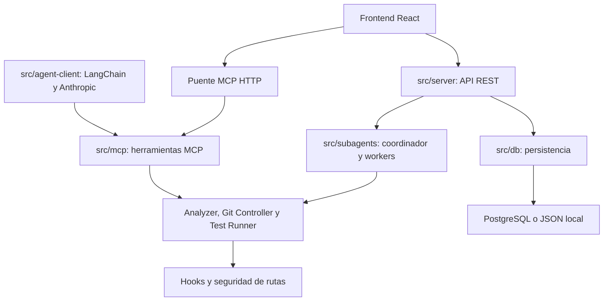

# Arquitectura actual

El frontend consume REST y el puente MCP HTTP. El cliente generativo CLI consume MCP; los workers deterministas y hooks controlan operaciones del motor. El diagrama describe responsabilidades, no todas las llamadas internas.

