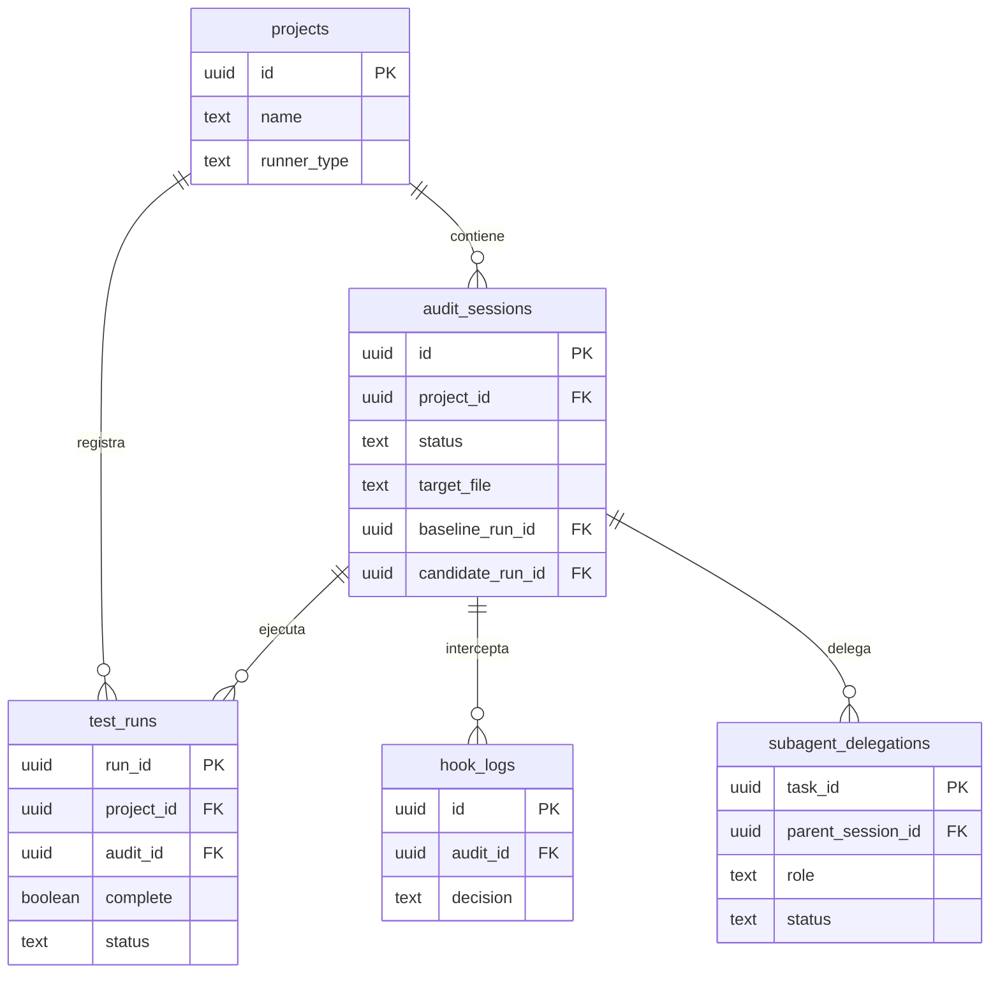

# Modelo de datos actual

Fuente: src/db/schema.sql. Modelo resumido de las cinco tablas reales; no es una migración. Una auditoría pertenece a un proyecto y contiene pruebas, intercepciones y delegaciones. Los enlaces baseline/candidato son opcionales y están restringidos a ejecuciones de la misma auditoría. Los detalles JSON y todas las restricciones permanecen en el esquema SQL.

