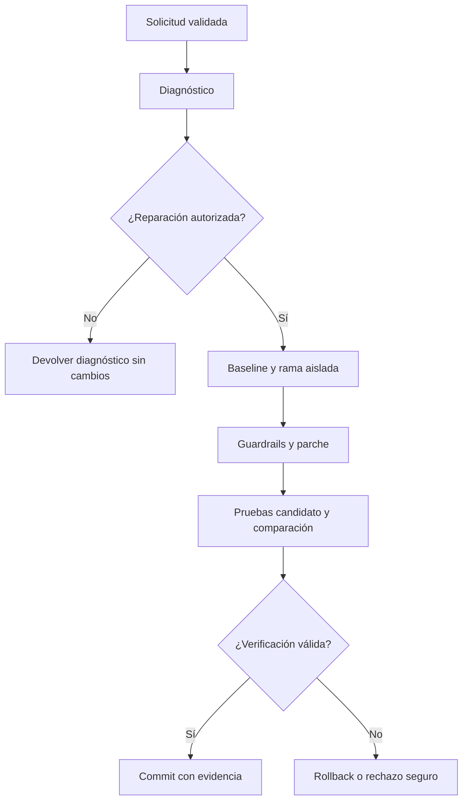

# Procesos actuales

El flujo de reparación exige autorización, evidencia y estado Git válido. El diagnóstico solo no crea rama ni commit. El diagrama es un resumen conceptual del motor, no una afirmación de que cada operación pase por todos los workers.

