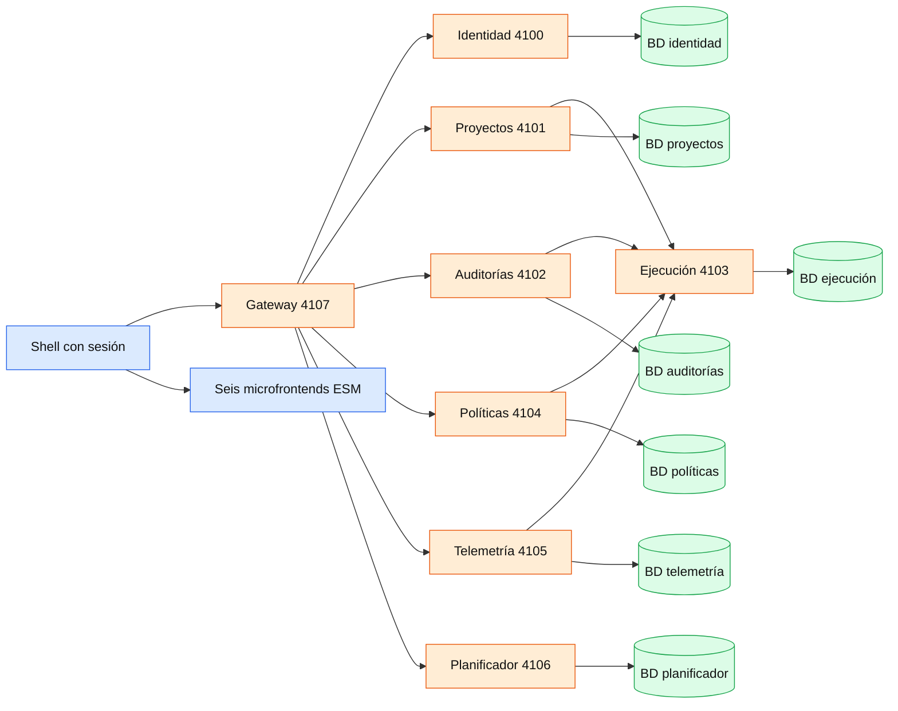
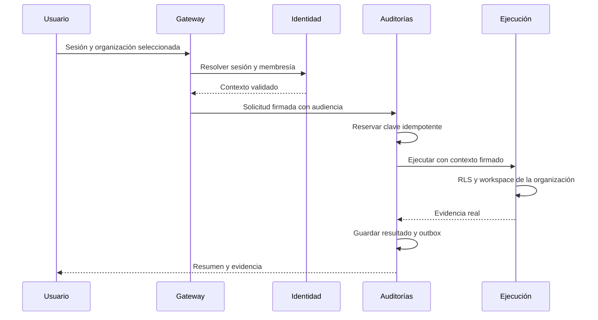

# Migración local: arquitectura implementada

El perfil `platform` coexiste con el arranque monolítico para comparar contratos y evitar una migración destructiva de datos existentes. Es un entorno local de transición, no el despliegue productivo de Render.

## Límites y propiedad de datos

| Servicio | Responsabilidad y persistencia |
|---|---|
| Identidad | Usuarios, organizaciones, membresías y sesiones revocables; valida membresía en cada solicitud |
| Proyectos | Registro por organización, callback de registro y reconciliación con las réplicas técnicas del motor |
| Auditorías | Diario de comandos idempotentes, resultados y desenlace desconocido sin repetición automática |
| Ejecución | AST, Git, pruebas y evidencia autoritativa permanecen juntos; conserva las cinco tablas técnicas con claves y FK tenantizadas |
| Políticas | Frontera HTTP de las políticas existentes del motor; aún no permite administrar políticas tenant específicas |
| Telemetría | Proyecciones consultables, inbox, cursor y consumo de outbox bajo demanda; nunca autoriza commits |
| Planificador | Generación de propuestas por LangChain y metadatos de solicitudes; requiere proveedor configurado, nunca aplica ni confirma cambios |

Cada servicio con datos recibe solo su propia conexión. Los roles son distintos, no propietarios y sin SUPERUSER/BYPASSRLS. Todas las tablas de ejecución y de agregados de dominio fuerzan RLS. Identidad utiliza consultas explícitas sobre su modelo de membresías: no se presenta su catálogo global de usuarios/sesiones como tenantizado mediante RLS.

## SOLID y patrones utilizados

- SRP: autenticación, transporte, persistencia, ejecución y composición de UI tienen límites separados.
- OCP: los paneles se publican mediante un contrato `mount/update/unmount` versionado; el motor conserva sus contratos existentes.
- LSP: el adaptador PostgreSQL tenantizado sigue implementando el repositorio existente.
- ISP: la identidad entrega contexto; telemetría entrega evidencia de lectura; ninguna adquiere autoridad para confirmar Git.
- DIP: el motor recibe un repositorio por interfaz y el transporte utiliza configuración validada, sin conexiones DB del frontend.
- Gateway/BFF, Adapter y Strangler: nueva entrada autenticada alrededor del motor, manteniendo el modo anterior explícito.
- Outbox e Inbox: eventos guardados en la misma transacción del agregado, proyección idempotente por evento y cursor tenantizado.
- Control optimista y diario de comandos: versiones esperadas y claves de idempotencia para no ejecutar dos veces una auditoría.
- Compensación: los parches siguen usando el rollback verificado del motor; no se afirma una transacción distribuida entre Git y PostgreSQL.

## Aislamiento y recorrido

## Límites pendientes antes de producción

1. Migración explícita de datos legacy y asignación de organización; no se asignan automáticamente datos históricos.
2. TLS/mTLS, gestor de secretos, rotación de claves, OIDC/recuperación de cuentas y despliegues separados.
3. Políticas tenant específicas administrables y su propagación segura a ejecución.
4. Consumidor continuo de eventos con reintentos y alertas; actualmente las proyecciones de eventos se actualizan bajo demanda.
5. Leases distribuidos, recuperación tras caída y sandbox de sistema operativo para ejecutar repositorios importados. Esas ejecuciones permanecen bloqueadas.
6. Verificar una reparación generativa real con un proveedor configurado: `createPlatformAgent` conecta el orquestador existente al MCP tenantizado e inyecta `RemoteRepairPlanner`; sin credencial del proveedor no se acredita generación real.

Estos límites impiden presentar esta entrega local como una migración productiva completa. Los remotos son artefactos independientes en el mismo origen; cambiar a orígenes de terceros requiere otro contrato de confianza y CSP, no habilitar CORS globalmente.
