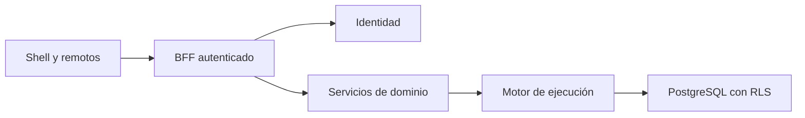

# Plan técnico

1. Añadir identidad, contexto firmado de servicio y persistencia PostgreSQL tenantizada.
2. Introducir servicios privados y BFF preservando el motor de ejecución y sus invariantes.
3. Provisionar un entorno PostgreSQL local aislado con datos nuevos y roles separados.
4. Separar la UI en Shell y remotos, con sesión y selección tenant.
5. Probar contratos, RLS real, flujo de usuario y builds; actualizar README y estados documentales.

## Decisión de compatibilidad

El modo legacy conserva sus tests actuales y se identifica como single-tenant; el nuevo arranque de plataforma exige identidad y datos privados. El motor mantiene sus registros técnicos de ejecución; las demás bases son propietarias de sus agregados y proyecciones sin FK remotas.

