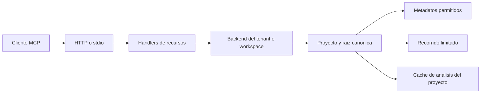

# Arquitectura

El gateway conserva sus controles de membresía y escritura para POST MCP. No se amplían permisos del rol viewer. El servidor independiente conserva su autenticación configurable existente.
