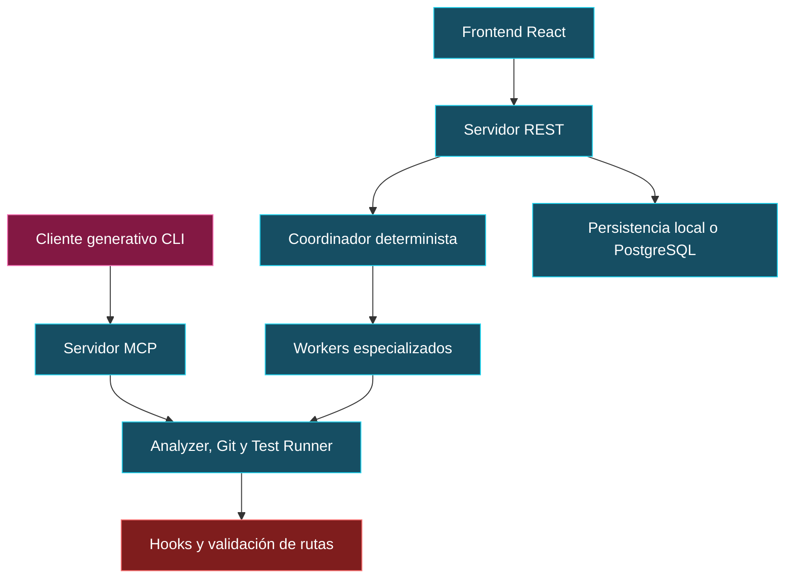

# Arquitectura, fachada y coordinación

El resumen menciona Facade y GRASP en ACF. Para DevGuardian, las fachadas públicas y la separación entre transporte y dominio ayudan a localizar responsabilidades. Los patrones se justifican por comportamiento concreto, no por el nombre de una clase.

El diagrama representa responsabilidades a alto nivel. REST y Agent Client no necesariamente recorren los mismos pasos.

## Relaciones

- [MCP y contratos](06-MCP-y-contratos.md)
- [Seguridad](07-Hooks-y-guardrails.md)
- [Workers e IA](09-IA-y-workers.md)

[Índice del segundo cerebro](00-Segundo-cerebro.md)
