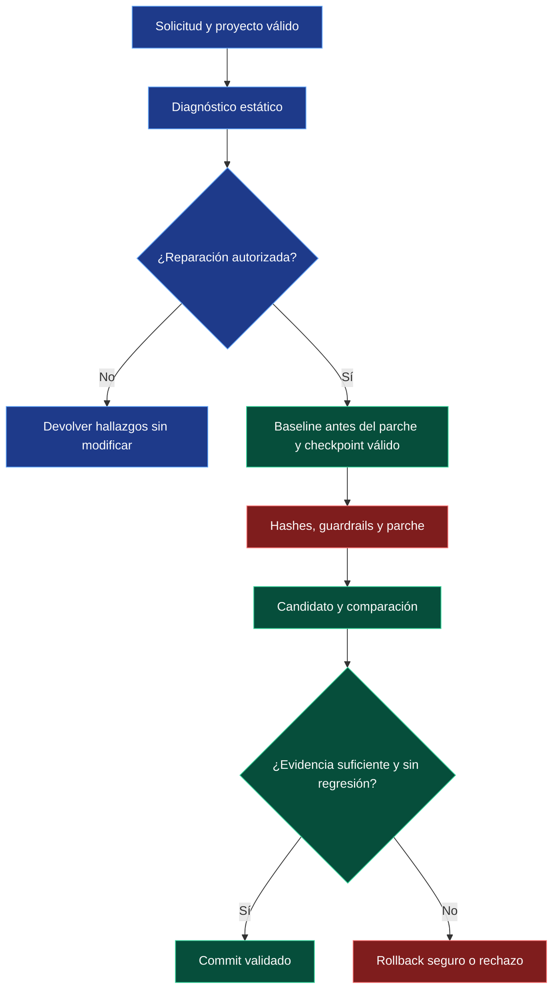

# Flujo de reparación con evidencia

Este esquema resume condiciones de seguridad; no sustituye los detalles de cada orquestador.

## Relaciones

- [Controles](07-Hooks-y-guardrails.md)
- [Regresiones](08-Verificacion-y-regresiones.md)
- [Orquestadores](09-IA-y-workers.md)

[Índice del segundo cerebro](00-Segundo-cerebro.md)
