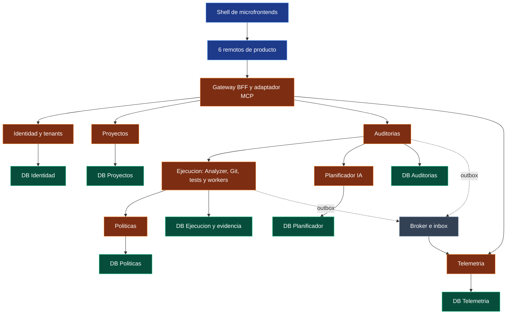

# DevGuardian: arquitectura objetivo

> Diseño objetivo, no implementación. Los cambios de aplicación requieren migración y verificación.

## Alcance y estado

Se adapta DevGuardian a los requisitos de microservicios, PostgreSQL relacional multitenant, SOLID explícito y microfrontends. Esta es la línea objetivo documentada: la aplicación actual sigue siendo un backend modular y un frontend React integrado. No se ejecutó una migración ni se publicaron nuevos servicios.

Tenant = organización/equipo. Objetivo: **7 servicios de dominio**, **1 Gateway BFF/MCP sin base de negocio**, **7 bases PostgreSQL lógicas privadas**, **1 Shell y 6 microfrontends**. Los módulos de Analyzer, Git y pruebas permanecen dentro del servicio de Ejecución por sus invariantes de workspace y evidencia. Una carpeta actual no equivale a un microservicio.

## Categorías y colores

| Categoría | Color | Etiqueta |
| --- | --- | --- |
| Frontend / microfrontends | Azul #60a5fa | dg/capa/frontend |
| Backend / microservicios | Naranja #fb923c | dg/capa/backend |
| Bases relacionales multitenant | Verde #34d399 | dg/capa/datos |
| Infraestructura | Gris #94a3b8 | dg/capa/infraestructura |
| Arquitectura, SOLID y patrones | Violeta #a78bfa | dg/capa/arquitectura |
| Seguridad transversal | Rojo #f87171 | dg/capa/seguridad |

## Grafo general

## Notas por módulo y decisión

- [Microservicio: Identidad y organizaciones](BE-Identidad.md)
- [Base relacional: Identidad y organizaciones](DB-Identidad.md)
- [Microservicio: Proyectos y preparación de workspace](BE-Proyectos.md)
- [Base relacional: Proyectos y preparación de workspace](DB-Proyectos.md)
- [Microservicio: Auditorías y orquestación](BE-Auditorias.md)
- [Base relacional: Auditorías y orquestación](DB-Auditorias.md)
- [Microservicio: Ejecución segura del workspace](BE-Ejecucion.md)
- [Base relacional: Ejecución segura del workspace](DB-Ejecucion.md)
- [Microservicio: Políticas de seguridad](BE-Politicas.md)
- [Base relacional: Políticas de seguridad](DB-Politicas.md)
- [Microservicio: Telemetría e historial consultable](BE-Telemetria.md)
- [Base relacional: Telemetría e historial consultable](DB-Telemetria.md)
- [Microservicio: Planificación generativa](BE-Planificador-IA.md)
- [Base relacional: Planificación generativa](DB-Planificador.md)
- [Gateway BFF y adaptador MCP](BE-Gateway.md)
- [Microfrontend: Mis proyectos](MF-Proyectos.md)
- [Microfrontend: Revisar código](MF-Revision.md)
- [Microfrontend: Resultados e historial](MF-Resultados.md)
- [Microfrontend: Seguridad](MF-Seguridad.md)
- [Microfrontend: Trazas de subagentes](MF-Subagentes.md)
- [Microfrontend: Sandbox MCP](MF-Sandbox-MCP.md)
- [Shell de microfrontends](MF-Shell.md)
- [Broker, outbox e inbox](INF-Broker.md)
- [Aislamiento del código externo](INF-Aislamiento.md)
- [Contratos, correlación y compatibilidad](INF-Contratos.md)
- [CI y entrega independiente](INF-Entrega.md)
- [Datos relacionales multitenant](AR-Multitenancy.md)
- [SOLID aplicado a DevGuardian](AR-SOLID.md)
- [Patrones de diseño e integración](AR-Patrones.md)
- [Composición de microfrontends](AR-Microfrontends.md)
- [Propiedad de datos y migración relacional](AR-Datos-y-migracion.md)
- [Flujo distribuido de reparación y recuperación](AR-Flujos.md)
- [Plan por etapas y criterios de aceptación](AR-Migracion.md)
- [Fuentes y decisiones pendientes](AR-Fuentes.md)

- [Seguridad transversal y límites de confianza](AR-Seguridad.md)

## Vistas

- [Cómo abrir grafos y categorías](Guia-Grafos.md).

- [Canvas completo por categorías](Arquitectura-Objetivo.canvas).
- [Estado actual](../arquitectura/00-Arquitectura-modulos.md).
- [Segundo cerebro conceptual](../00-Segundo-cerebro.md).

En el grafo nativo, usar path:"specs/segundo-cerebro" para reunir presente, conceptos y objetivo. Para ver solo el diseño nuevo, usar path:"specs/segundo-cerebro/arquitectura-objetivo". Cada nota del objetivo tiene estado diseno-no-implementado.

[Volver al índice](00-Arquitectura-Objetivo.md)
