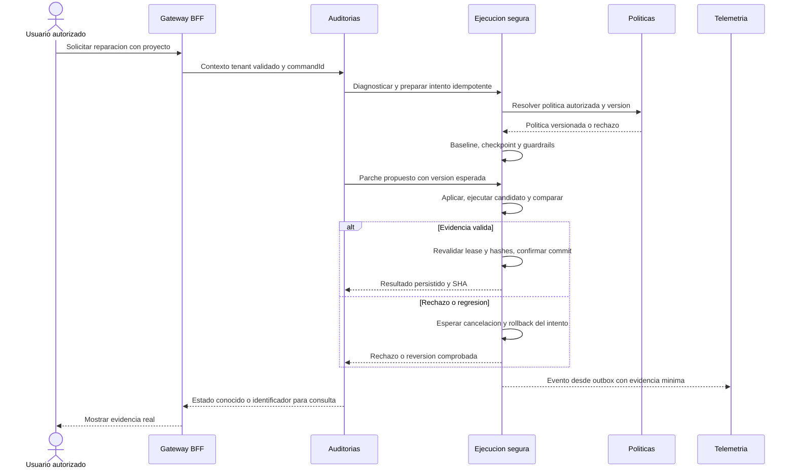

# Flujo distribuido de reparación y recuperación

> Diseño objetivo, no implementación. Los cambios de aplicación requieren migración y verificación.

## Invariantes

- Proyectos autoriza tenant/project y Ejecución resuelve la ruta privada.
- Auditorías decide el proceso; Ejecución es la única autoridad de Git, runs, hashes y evidencia del intento.
- No existe una transacción SQL que abarque Git, filesystem y bases de distintos servicios.
- Un commit requiere comparar runs completos, compatibles y del mismo estado; skip/todo y reports incompletos no acreditan reparación.
- Guardrails locales se aplican siempre, incluso si se usa MCP directo.

## Secuencia objetivo

## Fallos y reconciliación

Si Git confirmó y el proceso cayó antes de persistir su resultado, el reconciliador identifica el commit/árbol del intento y completa el journal; no vuelve a aplicar ni resetea un commit confirmado. El outbox debe reintentarse sin convertir una falla de publicación en rollback del código.

Si expira el lease, el ejecutor pierde permiso de mutar; detener procesos y poner ese workspace en cuarentena. No conceder a otro proceso la misma ruta antes de terminar o descartar el anterior: Git y filesystem no verifican por sí mismos un fencing token en PostgreSQL. Un nuevo intento puede usar otro checkout aislado.

Un rollback solo restaura el intento propio, con validación de rama y hashes, después de cancelar y esperar las herramientas. Si apareció trabajo ajeno, bloquear y reconciliar en vez de destruirlo. Telemetría retrasada no decide esta acción.

[Volver al índice](00-Arquitectura-Objetivo.md)
