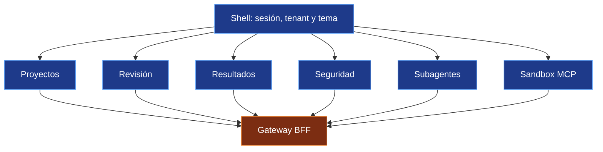

# Composición de microfrontends

> Diseño objetivo, no implementación. Los cambios de aplicación requieren migración y verificación.

## Fronteras

Un Shell y seis remotos: Proyectos, Revisión, Resultados, Seguridad, Subagentes y Sandbox MCP. Cada uno tiene artefacto, contrato y pipeline propio. El paquete UI compartido lleva tokens de diseño, componentes accesibles y temas; no transporta stores globales ni reglas de negocio.

## Carga y compatibilidad

Module Federation es la opción propuesta. Antes de fijarla ejecutar un spike con Vite/React actuales: montaje, shared react/react-dom y sus subrutas, navegación, CSS y fallo de red. Compartir versiones compatibles explícitamente; no permitir dos React incompatibles. Manifiestos con remoto, URL autorizada, versión y compatibilidad del Shell; rollback del manifiesto si el smoke test falla.

## Seguridad y datos

Todos los remotos comparten el contexto del navegador y pueden acceder a capacidades de esa página. No tratarlos como sandbox entre equipos o tenants. Validar orígenes/artefactos de despliegue, CSP y revisión de dependencias. El backend decide permisos y tenant en cada petición. Cambiar de tenant cancela peticiones/suscripciones y elimina cachés y resultados de la organización anterior; no reutilizar query keys sin tenant.

Referencia primaria: [Module Federation React Bridge](https://module-federation.io/guide/bridge/react/getting-started). Esta nota propone una composición y exige validar su compatibilidad antes de instalarla.

[Volver al índice](00-Arquitectura-Objetivo.md)
