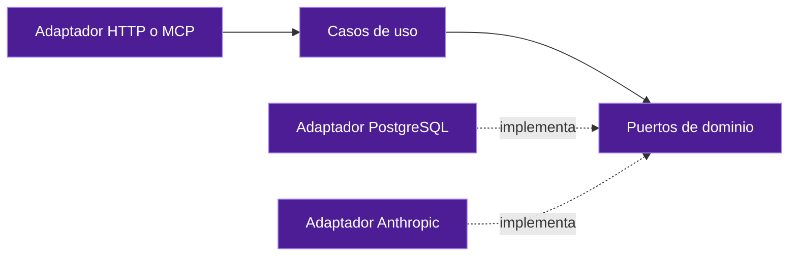

# SOLID aplicado a DevGuardian

> Diseño objetivo, no implementación. Los cambios de aplicación requieren migración y verificación.

## Principios y demostración concreta

| Principio | Aplicación obligatoria | Ejemplo de incumplimiento | Evidencia de aceptación |
| --- | --- | --- | --- |
| S: responsabilidad única | Planner propone; Ejecución aplica/verifica; Telemetría consulta | Un controlador HTTP que edita Git y genera prompts | Casos de uso independientes del transporte, con pruebas focalizadas |
| O: abierto a extensión | TestAdapter y PolicyRule extensibles con validación | Añadir un runner copiando condicionales en cada handler | Nuevo adaptador satisface contrato sin cambiar orquestación |
| L: sustitución | Adaptadores reales y dobles mantienen semántica de cancelación, errores y complete | Un fake declara complete aunque omita casos; JSON local finge aislamiento RLS | Suite contractual común y pruebas contra infraestructura real |
| I: segregación | WorkspaceReadPort, PatchPort, VerificationPort y AuditQueryPort | Dar git_commit_fix a un worker diagnostic | Roles reciben puertos/capacidades mínimas; pruebas de denegación |
| D: inversión | Casos de uso dependen de interfaces de dominio | Orquestador importa un pool pg global o ChatAnthropic directamente | Inyección de puertos y adaptadores en el composition root de cada servicio |

Los principios no se acreditan solo con interfaces o carpetas. Los contratos incluyen comportamiento, efectos, errores, límites, autorización y cancelación. Un adaptador local que no cumpla multitenancy no sustituye un repositorio de producción tenantizado.

## Separación propuesta de puertos

Ejemplo conceptual para el diseño; no modifica las interfaces TypeScript existentes.

```typescript
interface TenantContext { tenantId: string; subjectId: string; correlationId: string; }
interface WorkspaceReadPort {
  read(context: TenantContext, projectId: string, relativePath: string): Promise<ReadonlyFile>;
}
interface VerificationPort {
  verify(context: TenantContext, attemptId: string): Promise<VerifiedAttempt>;
}
interface PatchPort {
  apply(context: TenantContext, command: AuthorizedPatch): Promise<PatchOutcome>;
}
```

ReadonlyFile, VerifiedAttempt, AuthorizedPatch y PatchOutcome representan contratos a definir en la especificación de implementación. No son tipos añadidos al código. El identificador tenant en una interfaz no equivale a autorización: cada caso de uso valida contexto y permisos.

## Dependencias permitidas



[Patrones](AR-Patrones.md) y [contratos](INF-Contratos.md) concretan estas decisiones.


[Volver al índice](00-Arquitectura-Objetivo.md)
