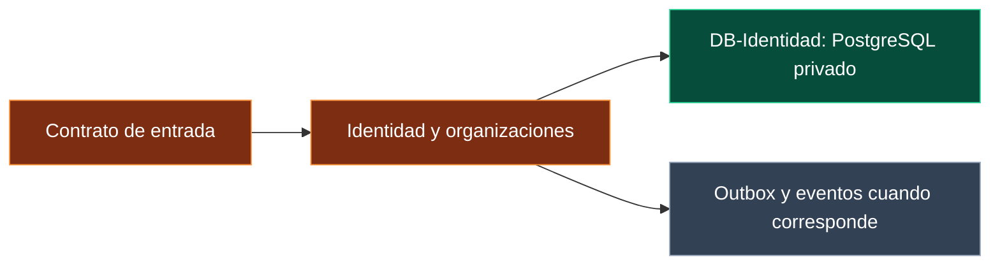

# Microservicio: Identidad y organizaciones

> Arquitectura objetivo solicitada. No acredita implementación, despliegue ni migraciones ejecutadas.

## Responsabilidad y frontera

Tenants, membresías y roles. Autentica mediante proveedor OIDC por seleccionar; mantiene permisos de plataforma y pertenencia a organizaciones.

**Procedencia actual:** src/server: autenticación actual a ampliar. Esto no convierte las carpetas en microservicios por sí solo: se requieren proceso, contrato, credenciales, pipeline y despliegue propios.

## Contratos y datos

- Entradas de aplicación validadas con Zod y contexto tenant autenticado.
- Propietario exclusivo de [DB-Identidad](DB-Identidad.md); ningún otro servicio tiene su usuario SQL.
- Comandos con commandId/idempotencyKey y expectedVersion cuando haya concurrencia.
- Eventos de integración versionados con outbox local e inbox deduplicada en consumidores.
- Tiempos límite, cancelación explícita y correlación sin secretos.

## Regla de seguridad

Comprobar pertenencia al tenant seleccionado; emitir o resolver un contexto interno con audiencia y alcance. No confiar en un tenant enviado por el navegador.

## SOLID y patrones aplicados

SRP: este dominio es la razón de cambio. DIP: casos de uso dependen de puertos, no del cliente HTTP/SQL concreto. Adapter y Repository aíslan infraestructura; Outbox solo para cambios que deban publicar eventos. Ver [SOLID](AR-SOLID.md) y [patrones](AR-Patrones.md).

## Criterios de aceptación

Aislamiento entre dos tenants, acceso denegado sin contexto, contrato compatible, reintento sin duplicar efecto y fallo recuperable. Para Ejecución se añaden pruebas de fencing, cancelación, hashes y evidencia de commit.

## Relaciones

- [DB-Identidad](DB-Identidad.md)
- [BE-Gateway](BE-Gateway.md)
- [AR-Multitenancy](AR-Multitenancy.md)
- [Índice de arquitectura objetivo](00-Arquitectura-Objetivo.md)
- [Arquitectura actual](../arquitectura/00-Arquitectura-modulos.md)
