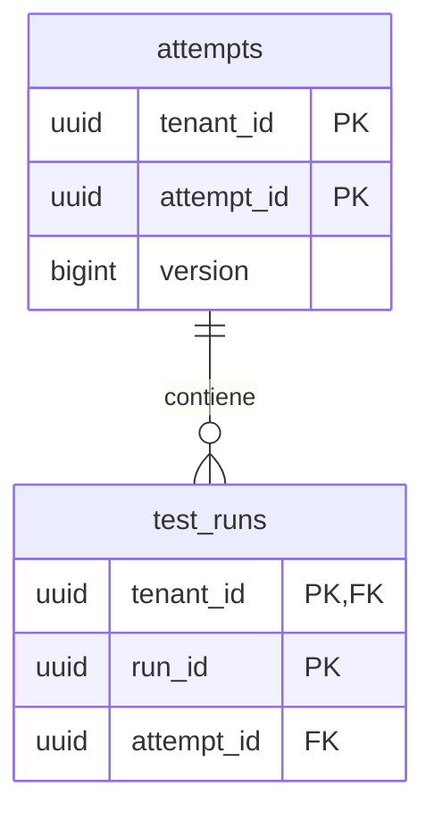

# Base relacional: Ejecución segura del workspace

> Arquitectura objetivo solicitada. No acredita implementación, despliegue ni migraciones ejecutadas.

## Propiedad y tenant

Propietario: [BE-Ejecucion](BE-Ejecucion.md). Base PostgreSQL lógica privada por servicio. Pueden compartir un clúster al principio con bases y roles separados; no implica siete servidores físicos. No existe una cuenta SQL compartida entre servicios.

Las filas de negocio tienen tenant_id NOT NULL. Claves, índices únicos y FK locales incluyen tenant_id para impedir referencias cruzadas. tenant_id identifica una organización autorizada, no un proyecto ni un usuario.

## Modelo mínimo propuesto

Este ER muestra una relación local central, no una migración exhaustiva. Cada servicio podrá añadir tablas de dominio, outbox, inbox y claves de idempotencia sin permitir joins entre bases.

## Integridad y acceso

FK solo dentro de esta base. Referencias a proyectos, usuarios o auditorías de otros servicios se validan por contrato/proyección; no se crean FK a otra base. RLS, roles separados y transacciones con contexto tenant se detallan en [multitenancy](AR-Multitenancy.md).

**Autoridad de commit:** ampliar el esquema mínimo con test_cases, comparison_evidence, workspace_leases y command_results. Vincular runs y comparaciones al intento con FK compuestas tenant/workspace/attempt. Guardar hashes y versiones inmutables. Una referencia a un run externo o a Telemetría no es suficiente.

## Verificaciones

Insertar, leer, actualizar y eliminar con tenant A nunca accede a B. Cambiar tenant en el body no elude autorización. Las conexiones reutilizadas del pool no heredan el contexto anterior. Las rutas administrativas se prueban aparte.

## Relaciones

- [BE-Ejecucion](BE-Ejecucion.md)
- [AR-Multitenancy](AR-Multitenancy.md)
- [AR-Datos-y-migracion](AR-Datos-y-migracion.md)
- [Índice de arquitectura objetivo](00-Arquitectura-Objetivo.md)
- [Arquitectura actual](../arquitectura/00-Arquitectura-modulos.md)
