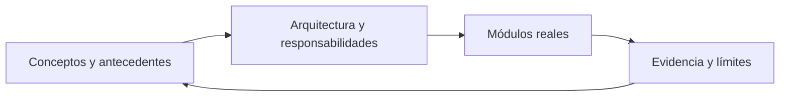

# Cerebro de arquitectura: módulos de DevGuardian

Complementa al [cerebro de conceptos y antecedentes](../00-Segundo-cerebro.md). Cada enlace representa una relación de responsabilidad documentada, no un flujo de red observado. GameZone permanece en otra bóveda.

- [Frontend: navegación, formularios y evidencia](01-Frontend.md)
- [Servidor REST y coordinación](02-Servidor-REST.md)
- [Servidor MCP y herramientas](03-MCP.md)
- [Contratos, errores y seguridad de rutas](04-Shared.md)
- [Analyzer: AST y ESLint](05-Analyzer.md)
- [Git Controller: intentos y evidencia](06-Git.md)
- [Test Runner: ejecuciones comparables](07-Test-Runner.md)
- [Subagentes deterministas y coordinador](08-Subagentes.md)
- [Hooks y guardrails del motor](09-Hooks.md)
- [Agent Client generativo: LangChain y MCP](10-Agent-Client.md)
- [Persistencia: proyectos, auditorías y trazas](11-Persistencia.md)
- [Integración con el asistente del IDE](12-Integracion-IDE.md)
- [Importación GitHub y progreso SSE](13-Importacion-GitHub.md)

## Lectura del grafo nativo

Las notas de conceptos y las de módulos se muestran juntas al filtrar por path:"specs/segundo-cerebro". Los enlaces entre ambas capas permiten ir de un concepto a su implementación. Las referencias al código son texto para no introducir nodos de dependencias ni archivos técnicos.

## Evolución solicitada

Esta página describe el estado actual. Consultar la [arquitectura objetivo multitenant y distribuida](../arquitectura-objetivo/00-Arquitectura-Objetivo.md) para los nuevos límites, principios y plan de migración.
