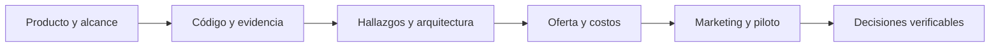

# DevGuardian: evaluación integral técnica y comercial

## Resumen ejecutivo

DevGuardian reúne diagnóstico estático, control Git, verificación de pruebas y trazabilidad mediante REST/MCP. Cuenta con implementación modular y documentación verificable; no debe presentarse como un SaaS multitenant ya listo para comercializar. La arquitectura distribuida es un objetivo documentado y tiene una ruta de migración.

La evaluación identifica ocho condiciones/brechas priorizadas para fortalecer seguridad, aislamiento, evidencia y operación. La propuesta comercial define segmentos, alternativas, oferta, costos, marketing, venta y experimentos, sin inventar clientes ni resultados de mercado.

## Documentos de la entrega

- [Alcance y método](01-Alcance-y-metodo.md).
- [Evidencia técnica actualizada](02-Evidencia-tecnica.md).
- [Hallazgos, riesgos y plan de cierre](03-Hallazgos-y-plan.md).
- [Evaluación arquitectónica](04-Evaluacion-arquitectonica.md).
- [Producto, mercado y competencia](05-Producto-y-mercado.md).
- [Modelo comercial, venta y costos](06-Modelo-comercial.md).
- [Marketing y métricas](07-Marketing-y-metricas.md).
- [Validación y entrega docente](08-Validacion-y-entrega-docente.md).
- [Canvas de la evaluación](Informe-Integral.canvas).

## Resultado de verificación local

Frontend: 119 pruebas aprobadas en 13 archivos. Check de tipos y lint: aprobado en ambos repositorios. Suite backend: inconclusa en esta revisión, con logs y criterio de reproducción documentados. No se sustituye ese resultado por el histórico del README.

## Qué se entrega y qué sigue abierto

La documentación técnica y comercial se entrega como evaluación académica con fuentes, evidencia y propuestas. No se acreditan cierre de hallazgos, migración multitenant, despliegues independientes, demanda comercial, ventas ni validaciones humanas no ejecutadas. Las pruebas locales no son una certificación ni la nota del docente.

## Relación con el proyecto

- [Segundo cerebro](../00-Segundo-cerebro.md).
- [Arquitectura objetivo, módulos y datos](../arquitectura-objetivo/00-Arquitectura-Objetivo.md).
- [SOLID](../arquitectura-objetivo/AR-SOLID.md).
- [Patrones](../arquitectura-objetivo/AR-Patrones.md).

## Flujo de evaluación

