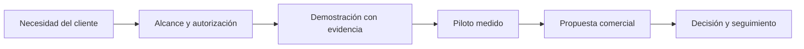

# Modelo de negocio, venta y costos

## Oferta propuesta, todavía no lanzada

- Piloto guiado: diagnóstico y entrega de evidencia con alcance limitado.
- Suscripción por equipo/tenant: proyectos y consumo con límites explícitos, solo después de verificar multitenancy.
- Servicio de acompañamiento: puesta en marcha y capacitación, sin prometer hallazgos o reparaciones garantizadas.

La unidad de cobro debe entenderse: equipo, proyecto o ejecución; no mezclar planes ilimitados con consumo LLM/CPU ilimitado. Una propuesta de precio requiere entrevistas, costos medidos y aceptación; no se inventa un precio de mercado.

## Costos a registrar

Infraestructura fija, PostgreSQL, almacenamiento y retención; minutos de ejecutor, tokens de proveedor, transferencia y eventos; soporte, mantenimiento, seguridad y adquisición de clientes. Separar costo académico gratuito temporal de costo comercial sostenible. Registrar proveedor, fecha, moneda e impuestos aplicables al cotizar, sin guardar credenciales.

## Modelo financiero de trabajo

- Costo variable por ejecución = CPU + tokens + almacenamiento incremental + transferencia atribuible.
- Margen de contribución por equipo = ingreso mensual del equipo - costo variable del equipo - soporte atribuible.
- Punto de equilibrio = costos fijos mensuales / margen de contribución promedio positivo por equipo.
- Si el margen no es positivo, no existe equilibrio bajo ese supuesto.
- Registrar escenarios conservador, base y alto usando volúmenes y costos medidos; no presentar escenarios como ventas.

## Proceso de venta propuesto

Descubrir necesidad, acordar alcance y autorización del repositorio, demostrar un caso controlado, entregar evidencia y límites, recoger objeciones, cotizar y decidir piloto. Antes de contrato: condiciones de tratamiento de código, propiedad del repositorio, permisos, retención, soporte y revisión legal aplicable. Esta nota no sustituye esa revisión.

## Puertas de comercialización

No ofrecer ejecución de repositorios hostiles ni aislamiento empresarial sin H01-H03 cerrados y pruebas. No afirmar disponibilidad o cumplimiento normativo sin evidencias. LLM y reparación automática se ofrecen únicamente con consentimiento, presupuesto y restricciones verificadas.

[Índice del informe](00-Informe-Integral.md)

## Ejemplo didáctico, no tarifa ni previsión de ventas

Valores en unidades monetarias (UM), sin representar cotizaciones de proveedores ni disposición a pagar validada. Si los costos fijos fueran 2.000 UM/mes y el precio de ejercicio 200 UM/equipo, los escenarios serían:

| Escenario ilustrativo | Variable + soporte por equipo | Contribución por equipo | Equipos para equilibrio |
| --- | --- | --- | --- |
| Costo alto | 140 UM | 60 UM | 34, redondeado hacia arriba |
| Base | 100 UM | 100 UM | 20 |
| Costo bajo | 60 UM | 140 UM | 15, redondeado hacia arriba |

Este cálculo no incluye automáticamente impuestos ni adquisición de clientes. Reemplazar las cifras con costos y ofertas reales antes de decidir un precio. No constituye ingreso obtenido, rentabilidad demostrada ni recomendación de inversión.
