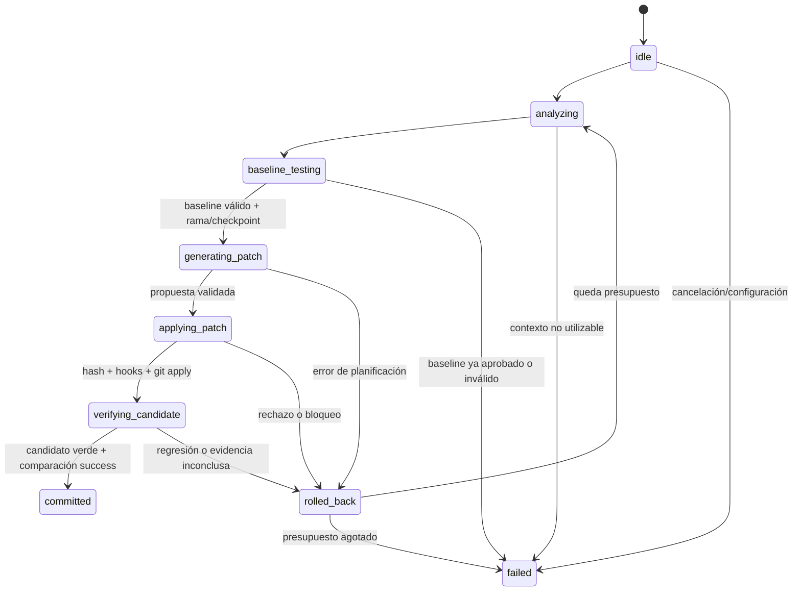

# Fase 6 — Agent Client generativo asistido

El cliente conecta LangChain/Anthropic con las **19 herramientas del servidor principal `src/mcp/`**. El modelo propone un cambio estructurado; TypeScript controla proyecto, archivo, hashes, sesiones, intentos, pruebas y decisión final. No se conceden al LLM herramientas de shell, filesystem ni Git.

Este es el camino MCP de herramientas primitivas aprobado para el MVP. No llama a `DevGuardianCoordinator.repair()` ni inicia automáticamente sus workers deterministas; ese coordinador continúa disponible en el flujo REST. Los errores lógicos con TypeScript válido se pueden reparar cuando existe un baseline conductual fallido.

## Archivos

| Archivo | Responsabilidad |
|---|---|
| `types.ts` | Configuración Zod, propuesta exclusiva código/diff, estados y resultados. |
| `mcp-bridge.ts` | Cliente SDK HTTP/stdio, validación de resultados, parámetros confiables y evidencia de hooks. |
| `planner.ts` | Mensajes LangChain, salida estructurada de ChatAnthropic, presupuestos y MockChatModel. |
| `orchestrator.ts` | Máquina de estados, política de aceptación, diffs, reintentos y rollback. |
| `main.ts` | CLI, lectura acotada de JSON, señales y salida sin credenciales. |
| `index.ts` | Exportaciones públicas y factory `createDevGuardianAgent`. |

Las dependencias LangChain y SDK ya estaban fijadas; se añade únicamente `tsx` 4.23.15 como dependencia de desarrollo. Se conservan TypeScript estricto, `exactOptionalPropertyTypes` y `skipLibCheck: false`. Las declaraciones instaladas de LangChain/SDK tienen incompatibilidades con esas opciones: un límite explícito carga sus implementaciones en ejecución, expone interfaces acotadas y valida los resultados con Zod. No se modifica `node_modules`. La suite prueba también ChatAnthropic real con HTTP del proveedor simulado.

## Máquina de estados y aceptación



1. Exige un repositorio limpio con HEAD y rama adjunta, usando `git_status`.
2. Consulta AST/lint y fuente completa acotada por MCP. Rechaza contexto truncado, demasiado grande o con contenido similar a secretos antes de enviarlo al modelo.
3. Captura baseline **antes de crear la rama**. Exige `complete`, `status: failed`, fallos reales, cero skipped/todo y salida no truncada. Si ya pasa, termina sin pedir un parche.
4. Crea una rama `fix/agent-UUID` e inicia un checkpoint. El hash de estado existente no incorpora el nombre de rama; Git vuelve a validar la huella del baseline contra el checkpoint.
5. Solicita únicamente `{ explanation, targetPath, replacementCode }` o `{ explanation, targetPath, unifiedDiff }`, nunca ambas representaciones. Los IDs/hashes se obtienen del servidor y los inyecta el cliente.
6. Aplica mediante `git_apply_patch`, con hash exacto y hooks. Rechaza localmente cambios de ruta, varios archivos, modos y archivos protegidos.
7. Ejecuta los mismos targets y `compare_test_runs`; el servidor registra la evidencia confiable.
8. Solo confirma si candidato completo/aprobado, sin truncamiento u omisiones, comparación comparable/success, fallos resueltos y ningún fallo nuevo/ausente. Obtiene un diff fresco y usa **candidate.runId** como `verificationRunId`.
9. Ante rechazo conocido, restaura únicamente el intento y realimenta al modelo si queda presupuesto. Reutiliza la rama y crea un intento nuevo, con análisis y baseline frescos. Al agotar intentos devuelve `failed`; `rolled_back` queda visible en `history`.

Los nombres/rutas aceptados por este MVP son archivos fuente ASCII `.ts`, `.tsx`, `.js`, `.jsx`, `.mts`, `.cts`, `.mjs` y `.cjs`, fuera de tests, dependencias, `dist` y metadatos. Solo se modifica un archivo existente. Se admite reemplazo vacío y se conservan CRLF/ausencia de newline en el generador de diff. Para `unifiedDiff` se exige un bloque Git de un solo archivo con cabeceras `diff --git`, `--- a/...` y `+++ b/...`.

Una instancia ejecuta `run()` una sola vez. Las invocaciones simultáneas se rechazan antes del primer await; para otra ejecución se crea otra instancia. También se rechazan `.env.*` aunque el nombre termine en una extensión de código, y se validan las rutas relativas de los helpers de diff.

## Configuración y límites

| Campo | Valor / condición |
|---|---|
| `projectId` | UUID de un proyecto ya registrado en la BD del servidor. |
| `targetPath` | Ruta relativa autorizada; nunca se toma de un texto libre del LLM. |
| `runner`, `targets` | Jest o pytest y targets confiables; idénticos en baseline/candidato. |
| `maxAttempts` | Predeterminado 3; rango 1–10. |
| `modelName` | `DEVGUARDIAN_MODEL` o `claude-sonnet-4-6`. Configurable para la cuenta/proveedor utilizado. |
| `apiKey` | Opcional en configuración programática; para CLI se recomienda `ANTHROPIC_API_KEY` del entorno. |
| `transportType` | `http` (predeterminado) o `stdio`. |
| `serverUrl` | HTTP: predeterminado `http://127.0.0.1:3001/api/mcp`. |
| `apiToken` | Bearer opcional para HTTP; CLI puede tomar `DEVGUARDIAN_API_TOKEN`. |
| `planningTimeoutMs` | 45000 por generación; máximo 120000. |
| `callTimeoutMs` | 45000 por llamada MCP; máximo 360000. |
| `maxDurationMs` | 300000 por ejecución; máximo 900000. Se observa entre operaciones y durante planificación. |
| `maxContextCharacters` | 40000 caracteres de fuente; máximo 60000. |

El modelo predeterminado figura activo en la [referencia oficial de Anthropic](https://platform.claude.com/docs/en/about-claude/model-deprecations) consultada al implementar. La disponibilidad comercial real depende de la cuenta; no se realizó una llamada con credenciales reales en la verificación.

La cancelación de planificación también se acota si un modelo inyectado ignora AbortSignal. Las llamadas MCP en curso se esperan hasta su resultado o timeout; cancelar el cliente no prueba que el servidor haya cancelado la mutación. Se reserva limpieza mediante rollback para resultados conocidos. Los límites de tokens de generación son 8192 y los retries de transporte del modelo están desactivados; `maxAttempts` gobierna los reintentos de reparación.

## Bloqueos de hooks y recuperación

El servidor añade `_meta.auditId` a `tools/call` sin alterar `Result<T>` ni el listado de 19 tools. La frontera MCP conserva `details` del error. Ante un rechazo, el cliente consulta `hooks_get_logs` por ese ID y conserva las decisiones `block`, `hookId` y `event` en `hookDecisionsCaught`.

El siguiente contexto contiene feedback explícito `POLICY BLOCK` y exige replantear dentro de la política. No se envía de nuevo el diff secreto rechazado ni se desactivan hooks. Un intento de cambiar `.env` como ruta diferente se rechaza localmente; eso no se presenta como un hook del servidor. La integración de secretos añadidos demuestra un bloqueo real de `pre:apply_patch` y una segunda propuesta válida.

`AgentExecutionResult` incluye `success`, `finalState`, `attemptsUsed`, `history`, `hookDecisionsCaught`, `durationMs`, `recoveryRequired`, y opcionalmente `auditId`/`commitSha`. `auditId` corresponde a la última llamada auditada; cada bloqueo conserva su propio ID. No es una nueva sesión DB que agrupe todo el ciclo generativo. Las llamadas individuales siguen usando el estado terminal DB `blocked` con `summaryJson.mode: mcp_tool` y `outcome`; consultar el resultado del agente para su desenlace global.

Si se pierde la respuesta de una mutación, expira el transporte o falla la persistencia de forma indeterminada, el agente devuelve `recoveryRequired: true`: **no repite la mutación ni afirma un rollback que no pudo verificar**. Inspeccionar HEAD, intento y auditoría antes de continuar. El estado Git y la evidencia activa viven en el proceso del servidor y expiran; reiniciar no reanuda el agente. La BD conserva el historial, no reconstruye su VerificationStore.

## Ejecución local con Mock o Anthropic

```powershell
npm.cmd ci
npm.cmd run build
npm.cmd run dev:server
```

En otra terminal, preparar un **checkout dedicado** con fallo real y registrarlo dentro de las raíces confiables del servidor. La [demo HTTP existente](../server/README.md#reparación-completa) crea el caso `src/bug.ts` y `tests/bug.test.cjs` apropiado. Los JSON de configuración/propuestas deben estar fuera del checkout auditado para que el árbol permanezca limpio.

Ejemplo PowerShell 7+ para ese caso; indicar su ruta al registrar el proyecto:

```powershell
$repo = Read-Host 'Ruta absoluta del checkout de demostración'
$registered = Invoke-RestMethod 'http://127.0.0.1:3001/api/projects' -Method Post -ContentType 'application/json' -Body (
  @{ name='Demo Agent'; repoPath=$repo; defaultBranch='main'; runnerType='jest' } | ConvertTo-Json
)
@{ projectId=$registered.data.id; targetPath='src/bug.ts'; runner='jest'; targets=@('tests/bug.test.cjs');
   maxAttempts=3; transportType='http'; serverUrl='http://127.0.0.1:3001/api/mcp' } |
  ConvertTo-Json | Set-Content -Encoding utf8 agent-config.json
@(@{ explanation='Corregir suma y preservar comportamiento existente'; targetPath='src/bug.ts';
     replacementCode="export const add = (a: number, b: number): number => a + b;`n" }) |
  ConvertTo-Json -AsArray | Set-Content -Encoding utf8 mock-proposals.json
npm.cmd run start:agent -- --config agent-config.json --mock mock-proposals.json
```

Si el servidor usa bearer, añadir su header al registro del proyecto y configurar `DEVGUARDIAN_API_TOKEN` para la CLI. El mock no necesita `ANTHROPIC_API_KEY`; confirma únicamente si las pruebas reales demuestran la reparación. Para repetir el éxito hay que recrear el fixture defectuoso: sobre el archivo ya reparado el baseline pasa y el agente se detiene.

Para Anthropic configurar `ANTHROPIC_API_KEY` fuera del repositorio, seleccionar `DEVGUARDIAN_MODEL` si corresponde y omitir `--mock`:

```powershell
npm.cmd run start:agent -- --config agent-config.json
# Si se utiliza una copia local .env ignorada por Git:
node --env-file=.env dist/agent-client/main.js --config agent-config.json
# Desarrollo TypeScript, usando variables del entorno de la terminal:
npm.cmd run dev:agent -- --config agent-config.json --mock mock-proposals.json
```

La CLI escribe el resultado JSON; exit 0 indica commit confirmado, exit 1 ejecución fallida o configuración inválida. Para obtener únicamente JSON al capturar stdout, usar `node dist/agent-client/main.js` directamente y evitar el encabezado de npm. Configuración y propuestas CLI admiten hasta 64 KiB por archivo.

Para stdio usar `transportType: stdio` y configurar `DEVGUARDIAN_DB_MODE`, `DEVGUARDIAN_DB_PATH` y `DEVGUARDIAN_WORKSPACE_ROOT` igual que al registrar el proyecto. La factory admite rutas confiables `stdio.cwd`/`serverPath` y configuración de entorno DB/workspace. Lanza directamente `node dist/mcp/index.js` y no transmite la clave de Anthropic al proceso MCP. Mantener una única conexión durante toda la ejecución.

## Pruebas y límites de la entrega

```powershell
npm.cmd run check
npm.cmd run build
node --experimental-vm-modules node_modules/jest/bin/jest.js --runInBand tests/agent-client/agent.test.mjs
npm.cmd test
```

La suite usa puertos efímeros, BD y repositorios temporales, MCP real, Jest real y MockChatModel. Comprueba éxito, regresión, bloqueo/replanificación, presupuesto, baseline ya aprobado, trabajo ajeno, propuestas inválidas, cancelación, autenticación, stdio, CLI, diffs CRLF y respuesta perdida. Un caso usa ChatAnthropic real con `fetch` simulado: verifica el formato de tool calling sin consumir API ni requerir una clave real en Actions.

Verificación de la entrega: `npm.cmd run check` sin errores y **285 pruebas aprobadas en 10 suites, sin fallos ni omisiones**: las 257 existentes y 28 nuevas del agente. Se ejecutó con pytest y `pytest-json-report` disponibles y `DEVGUARDIAN_REQUIRE_PYTEST=1`.

El agente debe operar sobre un checkout dedicado con un único reparador activo. La serialización del servidor es por llamada; no existe un lease distribuido para todo el ciclo ni una transacción Git/BD. El sistema detecta cambios externos y falla de forma segura; no bloquea editores ajenos. Los tests ejecutan código con los permisos del servidor: esto no es un sandbox del sistema operativo. La sanitización de secretos es heurística y la política no sustituye una revisión de seguridad del código propuesto. No se despliegan servicios externos en esta fase.
