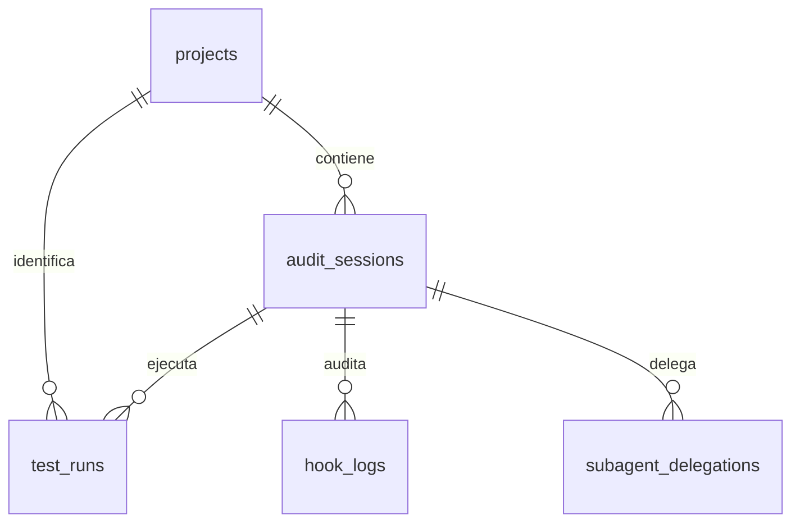

# Persistencia de DevGuardian

`createDatabaseRepository()` ofrece el mismo contrato `DevGuardianRepository` con JSON local durable o PostgreSQL. `AuditPersistenceService` conecta esa persistencia al coordinador real, hooks y delegaciones. No necesita una API HTTP para verificar la conservación de datos; el frontend podrá consumir estos métodos mediante la futura API.

## Modelo de datos



| Tabla | Clave y contenido |
|---|---|
| `projects` | UUID; nombre, raíz canónica del repositorio, rama predeterminada, runner y creación. |
| `audit_sessions` | UUID y FK a proyecto; estado, archivo, rama, baseline/candidato, commit, fechas y `summary_json`. |
| `test_runs` | `run_id`; FK compuesta a auditoría/proyecto, runner/estado, integridad, hashes, resumen, casos y fechas. |
| `hook_logs` | UUID determinista por decisión/auditoría; evento, allow/block/warn, razón, metadatos, duración y fecha. |
| `subagent_delegations` | `task_id`; FK `parent_session_id` a auditoría, especialista, contexto, llamadas, salida, consumo y fechas. |

Cada tabla tiene además `record_json` para recuperar el contrato TypeScript completo, incluidas las trazas que no caben en una proyección de columnas. Los adaptadores escriben columnas y JSON conjuntamente. `audit_sessions.summary_json.findings` conserva los hallazgos y `attempts` conserva sesión Git, intento, checkpoint y rama; no se inventan tablas de hallazgos o intentos fuera de las cinco solicitadas. El resultado final se conserva en `summary_json.result`.

Las delegaciones se actualizan por `task_id`, pero `snapshots` conserva el diario de fases `delegated → returned → consumed`, incluidas decisiones sucesivas de consumo. No se permite reescribir su prefijo. Las referencias baseline/candidato apuntan a runs de la misma auditoría. Los proyectos y las ejecuciones son inmutables; las auditorías tienen transiciones validadas y son inmutables después de finalizar. Decisiones de hooks repetidas son idempotentes, incluso cuando el registro de auditoría llama a los dos métodos del adaptador.

## Archivos y contratos

- `types.ts`: entidades y esquemas Zod, errores sanitizados, interfaz pública e interfaz SQL inyectable.
- `repository.ts`: reglas de integridad compartidas por ambos modos.
- `local-adapter.ts`: snapshots atómicos y bloqueo entre instancias/procesos cooperantes.
- `postgres-adapter.ts`: pool `pg`, consultas parametrizadas y transacciones.
- `schema.sql` / `migrations.ts`: DDL PostgreSQL y migración versionada con checksum.
- `bridges.ts`: adaptadores de hooks/delegaciones y servicio de auditorías.
- `index.ts`: factory y exportaciones.

Los métodos de dominio lanzan errores tipados; un handler MCP/API puede envolverlos con `captureResult`. La capa DB no importa un frontend ni expone endpoints públicos.

## Selección de modo

| Configuración | Selección |
|---|---|
| Sin `DATABASE_URL` | Archivo local. |
| `DEVGUARDIAN_DB_MODE=local` | Archivo local, aunque exista una URL. |
| `DATABASE_URL` y sin modo local | PostgreSQL, con migraciones al abrir. |
| `DEVGUARDIAN_DB_MODE=postgres` sin URL | Error; no hay fallback silencioso. |

`DB_MODE` se admite como alias; `DEVGUARDIAN_DB_MODE` tiene precedencia. Un modo desconocido falla. `DEVGUARDIAN_DB_PATH` controla el archivo local, por defecto `./data/devguardian-db.json`, relativo al directorio de arranque. Las ubicaciones, adaptadores y credenciales son configuración confiable del backend, nunca parámetros elegibles por un agente o navegador.

`.env.example` contiene únicamente valores ficticios. El proceso no carga `.env` automáticamente: configurar las variables del hosting o iniciar Node con `--env-file=.env`. La copia `.env`, el archivo JSON y sus temporales/locks están ignorados por Git para las rutas documentadas.

## Archivo local: durabilidad y límites

Cada operación vuelve a leer el snapshot de disco, por lo que dos instancias no mantienen cachés divergentes. Las escrituras usan un lock creado con `wx`, validan el estado actual, escriben un temporal en el mismo directorio, hacen `fsync` y lo renombran sobre el destino. En POSIX también se sincroniza el directorio. Una operación inválida conserva el snapshot anterior. Los lectores ven un archivo completo anterior o nuevo.

Se rechazan padres simbólicos, archivos con múltiples hard links, metadatos `.git` y objetos especiales. Se aplican las validaciones de `WorkspacePathGuard`. El lock coordina escritores que usan este adaptador; el directorio debe ser privado y no estar sujeto a modificaciones de procesos hostiles. Los archivos se crean con permisos POSIX `0600`; en Windows se deben conservar ACL de usuario adecuadas.

El archivo tiene límite de 32 MB, comprobado antes de leerlo completamente y antes de guardar. El timeout de lock es de 5 segundos por defecto, configurable al crear el adaptador. Un lock abandonado tras una caída no se elimina automáticamente: detener o verificar los procesos propietarios y revisar el archivo antes de retirarlo manualmente. Un JSON corrupto o de versión incompatible provoca error y se conserva para recuperación. Mantener backups fuera del repositorio; para varios usuarios o mayor volumen se debe usar PostgreSQL.

`close()` impide nuevas operaciones y espera las ya iniciadas. No existe una transacción distribuida entre Git y la BD: si la persistencia final falla después de un commit, inspeccionar el estado Git y reconciliar la auditoría; no repetir automáticamente la reparación. Las escrituras de baseline/candidato y checkpoint ocurren antes de autorizar la siguiente mutación. Un proceso que cae deja una auditoría `running` consultable para recuperación.

## PostgreSQL local o cloud

Configurar `DATABASE_URL` mediante los secretos del proveedor y establecer `DEVGUARDIAN_DB_MODE=postgres`. En Render/Supabase/Neon usar una URL del servicio PostgreSQL accesible desde el backend. Si se utiliza un pooler, debe soportar transacciones y DDL para migrar, o se debe ejecutar la migración con la conexión directa antes de usarlo.

No se desactiva la validación de certificados. Configurar TLS y la CA conforme al proveedor; para validar identidad se puede utilizar `sslmode=verify-full` y `sslrootcert` cuando corresponda. Evitar combinar parámetros SSL de la URL con un objeto SSL que los sobrescriba. Referencia: [TLS en node-postgres](https://node-postgres.com/features/ssl).

El pool tiene cinco conexiones como máximo, timeout de conexión de 10 segundos y límites de consulta/transacción. Cada transacción usa un único cliente. Las escrituras adquieren un advisory lock transaccional para mantener las mismas invariantes que el adaptador local. Todos los valores van en `$1`, `$2`, etc.; los identificadores SQL proceden de constantes internas. Referencias: [consultas parametrizadas](https://node-postgres.com/features/queries) y [transacciones y clientes del pool](https://node-postgres.com/apis/pool).

Al abrir, `runMigrations()` crea las cinco tablas, índices, checks y claves foráneas dentro de una transacción. La tabla técnica `devguardian_migrations` conserva versión/checksum; un advisory lock evita aplicar el esquema simultáneamente. Un esquema ya aplicado debe conservar su checksum; ampliar el modelo mediante una nueva migración, no reescribir una aplicada. La copia SQL se incluye en `dist/db/schema.sql` mediante `npm run build`; distribuir `dist/` completo.

## Integración real

```ts
import { createDatabaseRepository, AuditPersistenceService } from './db/index.js';

const repository = await createDatabaseRepository();
try {
  const persistence = new AuditPersistenceService(repository);
  const project = await persistence.registerProject({
    name: 'Mi repositorio', repoPath: '/absolute/path/to/dedicated-checkout',
    defaultBranch: 'main', runnerType: 'jest'
  });
  console.log(project.id);
} finally {
  await repository.close();
}
```

`repairProject()` crea la auditoría, fija su ID como `parentSessionId`, construye los adaptadores DB y los hooks y ejecuta `DevGuardianCoordinator`. Se pueden usar también `beginAudit`, `saveTestRun`, `finishAudit` y `getAuditDetails` desde una futura capa de aplicación. Los callbacks opcionales `onTestRun` y `onAttemptStarted` del coordinador desacoplan la persistencia de los motores de dominio.

Por defecto el servicio no guarda stdout/stderr arbitrarios de las pruebas. No se persisten el diff propuesto ni la URL de conexión; el preflight de patches conserva su hash. Los hallazgos, fragmentos de código y mensajes de fallo pueden contener información del proyecto: la futura API debe aplicar autorización y la BD debe disponer de controles de acceso. El detector de secretos de hooks sigue siendo heurístico.

## Verificación de reinicio y evidencia de despliegue

```sh
npm run db:verify
```

Este comando crea un proyecto y una auditoría de demostración explícitamente marcada como prueba de persistencia, cierra el repositorio, crea otra instancia y consulta los registros. Imprime solamente adaptador, IDs, estado y `recoveredAfterReopen: true`. No ejecuta una reparación en el repositorio principal. Para volver a consultar desde otro proceso:

```sh
npm run db:verify -- UUID_DE_LA_AUDITORIA
```

Para comprobar PostgreSQL en un entorno configurado, ejecutar el mismo comando con `DATABASE_URL` y modo `postgres`. Una URL declarada o un mock no acreditan despliegue: para los 10 puntos de BD desplegada, aprovisionar el servicio cloud, ejecutar esta verificación desde el backend conectado, reiniciar y conservar IDs y evidencia de la segunda consulta sin exponer credenciales. El proveedor aún no se aprovisiona desde este módulo; tampoco hay dashboard HTTP que pueda recargarse todavía.

## Pruebas

```sh
npm.cmd run check
npm.cmd test
```

`tests/db/db.test.mjs` incluye CRUD, integridad, transiciones, registros inmutables, copias defensivas, bloqueo entre instancias y procesos, corrupción y seguridad de rutas. La integración usa analizador y Jest reales, persiste commit y regresión/rollback y comprueba igualdad de datos en otro proceso Node después de cerrar el repositorio original. También verifica hooks aceptados/bloqueados y las tres delegaciones con sus consumos.

Las pruebas PostgreSQL usan un cliente inyectado que comprueba sentencias, parámetros, migraciones, rollback y actualización del diario, sin necesitar red ni un servidor en Actions. Ese mock no demuestra por sí mismo compatibilidad con un servidor ni TLS o despliegue cloud.

En la verificación de implementación se levantó además un PostgreSQL real temporal, accesible solo en loopback: se ejecutaron migraciones dos veces, operaciones sobre las cinco tablas, hooks allow/block, tres snapshots de delegación y una reapertura con datos idénticos. El servidor temporal se detuvo y eliminó después. Esta prueba adicional no constituye un despliegue cloud ni sustituye su evidencia.
