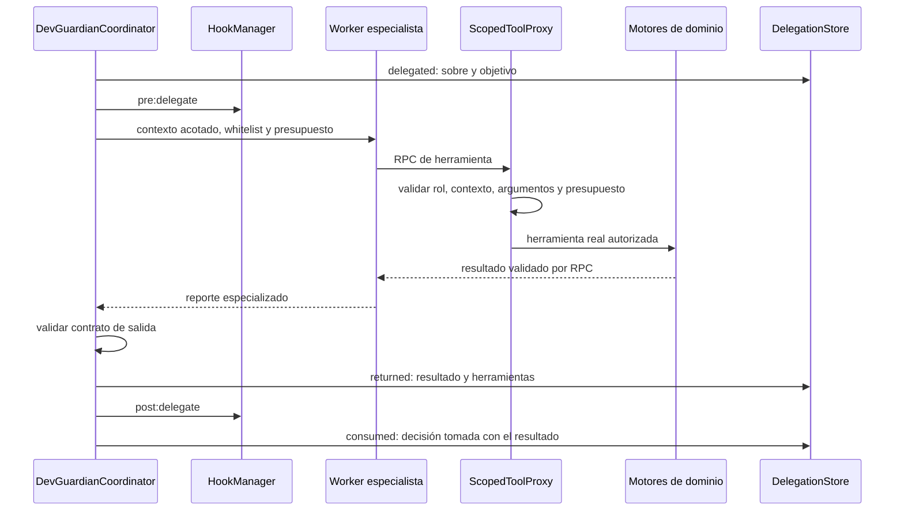

# Subagentes: delegación real y auditable

DevGuardian delega tareas delimitadas a especialistas deterministas que se ejecutan en **workers independientes**. El coordinador envía un `SubagentTaskEnvelope`; el worker decide su secuencia de herramientas, recibe resultados por RPC y devuelve un reporte propio. El host valida el contrato de salida y el coordinador consume ese resultado para continuar o revertir el flujo. No se necesita una API key ni se simulan respuestas de un LLM.

## Arquitectura y aislamiento



| Componente | Responsabilidad |
|---|---|
| `types.ts` | Sobres, presupuestos, contratos Zod de contexto/salida y registros |
| `runtime.ts` | Crear un worker por tarea; RPC, permisos y presupuestos en el host |
| `worker.ts` | Despachar al especialista con estado local y sin motores globales |
| `specialists.ts` | Estrategias independientes de diagnóstico, verificación y preflight |
| `coordinator.ts` | Delegación registrada y flujo real de reparación |
| `store.ts` | Diario de delegaciones y adaptador de persistencia |
| `index.ts` | Factories, tipos, especialistas y consultas públicas |

La prueba de delegación incluye `taskId`, `subagentId`, `workerThreadId`, mensajes RPC efectivos y el resultado consumido. Un worker nuevo por tarea, con su propio heap y `workerData` clonado, impide compartir accidentalmente el contexto global del coordinador. Se omiten las variables de entorno del host, no se pasan instancias de servicios ni credenciales y se limita el heap del worker a 64 MiB.

Es un aislamiento de contexto y capacidades para **especialistas confiables incluidos en el proyecto**. Los workers Node no son un sandbox del sistema operativo para ejecutar JavaScript hostil. Los motores residen en el host; el analizador puede leer dependencias del proyecto para resolver tipos y los tests son código arbitrario. Un análisis síncrono largo en el host puede retrasar el temporizador: al regresar se rechaza el resultado vencido. La cancelación de pruebas usa `AbortSignal`, espera la limpieza de la herramienta en curso y después permite el rollback. Una herramienta confiable que ignore la cancelación también puede retrasar esa limpieza.

## Roles y mínimo privilegio

| Rol | Contexto recibido | Capacidades |
|---|---|---|
| `diagnostic` | Una ruta objetivo | `analyze_code`, `read_file_context` |
| `verification` / baseline | Runner y targets | `run_tests`; sin comparación válida todavía |
| `verification` / candidato | Runner, targets y `baselineRunId` | `run_tests`, `compare_test_runs` |
| `patch-safety` | Lista de archivos y diff acotado | `inspect_patch`: preflight de hooks, sin escritura Git |

La whitelist solicitada se intersecta por validación con el rol fijo: declarar `git_commit_fix` como permitido en un sobre de diagnóstico no concede acceso. El proxy también limita argumentos: diagnóstico no puede cambiar de archivo; verificación no puede cambiar de runner/targets ni comparar otros IDs de ejecuciones. Los intentos rechazados quedan en el diario con `dispatched: false` y nunca alcanzan un servicio de dominio.

`TaskBudget` limita llamadas realmente despachadas y tiempo total. El presupuesto se reserva antes de invocar cada handler para impedir rebasarlo con solicitudes concurrentes. Una violación de permisos o presupuesto es terminal. Un vencimiento termina el worker y cancela las herramientas pendientes; un fallo no se convierte en un resultado listo para commit.

## Flujo completo

1. Diagnóstico delegado: análisis real de sintaxis/semántica/lint, hasta diez hallazgos priorizados, fragmento exacto, SHA-256 y causa localizada. La remediación automática exige un error estático localizado y resultados completos.
2. El coordinador consume el diagnóstico y verifica que el hash del parche coincida con la fuente diagnosticada. Crea `fix/...` y un intento con checkpoint. La API de reparación limita el parche a ese archivo.
3. Delega una tarea de verificación para capturar el **baseline antes de aplicar el parche**. Solo continúa con un baseline fallido, completo, vigente y sin skipped/todo.
4. Aplica el parche mediante Git Controller, disparando `pre:apply_patch`. El parche lo proporciona el llamador: este módulo no genera parches con un modelo.
5. Delega otra tarea de verificación. El especialista ejecuta el candidato y solicita `compare_test_runs`. El adaptador conecta esa llamada con `TestRunner.verify`, que compara y registra evidencia confiable en el mismo `VerificationStore` utilizado por Git Controller.
6. `ready_to_commit` autoriza intentar el commit con `verificationId`; los hooks y las verificaciones existentes de Git vuelven a exigir evidencia vigente y hashes correctos. `regression_detected`, skipped/todo, evidencia inconclusa o un fallo de delegación provocan rollback.
7. El registro `consumed` conserva la decisión y el commit real o la razón de rollback. Se serializan reparaciones por instancia del coordinador; se recomienda un checkout dedicado sin escritores externos.

El rollback conserva la rama `fix/...`, restaura el intento y mantiene HEAD cuando no hubo commit. Si no puede restaurar con seguridad, el resultado es `recovery_required`; no se informa una reversión inexistente. Una caída de persistencia después de un commit también informa recuperación de auditoría, conservando el hash del commit ya realizado.

El preflight de `patch-safety` es una delegación opcional mediante `agent.createTask`/`agent.delegate`. El flujo de reparación siempre aplica los guardrails dentro de Git Controller usando las rutas inspeccionadas por Git; un preflight externo no sustituye esa protección.

## Protocolo y trazas

Un `SubagentTaskRequest<TPayload>` contiene `taskId`, `parentSessionId`, `role`, `objective`, `scopedContext`, `allowedTools` y `budget`. Los esquemas estrictos rechazan campos globales no autorizados en el contexto.

`SubagentTaskResult<TOutput>` devuelve estado `completed`, `rejected`, `budget_exceeded` o `failed`; reporte validado o `null`; identidad del especialista y del worker; timestamps; duración; y `toolCallsExecuted`. Cada llamada incluye input autorizado, resumen de salida, estado, duración y si realmente se despachó. Los intentos denegados no conservan input arbitrario. stdout/stderr de tests y cuerpos completos de archivos no se duplican en el diario por herramienta.

`DelegationRecord` conserva:

- `delegationId` y `coordinatorId`: quién delegó e identidad de la delegación.
- `request`: tarea acotada y presupuesto; los diffs de preflight se sustituyen por su SHA-256 en la traza.
- `phase`: snapshots append-only `delegated`, `returned`, `consumed`.
- `result`: reporte del especialista, identidades y llamadas efectivas.
- `consumption`: decisión del coordinador, explicación y fecha. Puede haber más de un snapshot de consumo para registrar autorización y confirmación de commit.

```ts
import { getDelegationLogs, getDelegationSummary } from './index.js';
const logs = getDelegationLogs(coordinator.delegationStore);
const summary = getDelegationSummary(coordinator.delegationStore);
console.log(JSON.stringify({ logs, summary }, null, 2));
```

Las consultas y el adaptador reciben copias defensivas. `DelegationPersistenceAdapter.append(record)` permite conectar BD desde el backend. Las escrituras se esperan antes de avanzar: si falla el primer registro no se inicia un worker; si falla el registro de retorno no se autoriza una mutación siguiente. La copia en memoria conserva lo observado para recuperación. No hay transacción distribuida entre Git y BD, ni retención automática; los logs en memoria no sobreviven al reinicio. Los reportes contienen fragmentos de código y necesitan control de acceso en futuros endpoints API/MCP.

## Integración con hooks

`pre:delegate` valida o bloquea antes de crear el worker; `post:delegate` registra su retorno. Ambos incluyen metadatos `taskId`, `parentSessionId`, rol y, al retornar, `subagentId`. Hook Manager los registra y emite su auditoría `db:on_hook_decision`. Los hooks de análisis, pruebas, aplicación de parches y commits se mantienen en el flujo real.

Ejemplo de política adicional:

```ts
coordinator.hooks.register({
  id: 'verification-policy', name: 'Verification policy', events: ['pre:delegate'],
  execute: ({ delegation }) => ({
    decision: delegation?.role === 'verification' ? 'block' : 'allow',
    reason: 'Verification requires operator policy approval.'
  })
});
```

## Configuración y uso

```ts
import { DevGuardianCoordinator } from './index.js';
const coordinator = await DevGuardianCoordinator.create({
  workspaceRoot: '/absolute/path/to/dedicated-checkout',
  runners: [{ runner: 'jest', executable: process.execPath,
    args: ['/absolute/path/to/jest/bin/jest.js', '--runInBand'],
    timeoutMs: 30_000, maxOutputBytes: 100_000 }],
  // hookManager y delegationAdapter son dependencias confiables opcionales.
});
const diagnosis = await coordinator.diagnose('src/bug.ts');
// Para reparar: coordinator.repair({ path, slug, message, unifiedDiff,
//   expectedFileHashes, runner: 'jest', targets: ['tests/bug.test.cjs'] });
console.log(diagnosis, coordinator.delegationStore.getDelegationLogs());
```

Presupuesto predeterminado por tarea: 6 llamadas y 60 segundos. `repair({ ..., budget })` puede reducirlo o aumentarlo hasta los máximos validados de 100 llamadas y 300 segundos. Los runners, hooks y adaptadores se configuran en arranque, nunca como capacidades elegibles por el especialista.

## Defensa reproducible

Desde la raíz, con Node 24, Git y dependencias instaladas:

```sh
npm run check
npm test
```

Para la suite específica, después de compilar:

```sh
node --experimental-vm-modules node_modules/jest/bin/jest.js --runInBand --verbose tests/subagents/subagents.test.mjs
```

Para generar evidencia visible y persistida de ambos flujos:

```sh
npm run build
node scripts/demo-subagents.mjs
```

La demo crea repositorios temporales, usa el analizador y **Jest real**, hace un commit verificado en el caso aceptado y un rollback en el de regresión. Guarda `artifacts/subagents/success.json` y `artifacts/subagents/regression.json`, con invocaciones, resultados, consumo, configuración de hooks, logs de hooks y auditorías; después elimina únicamente sus repositorios temporales.

Durante la defensa, abrir el JSON y recorrer `delegationLogs`: contexto enviado → `workerThreadId` → herramientas reales → dictamen devuelto → `consumption`. Mostrar después `hookLogs` y los hashes `originalHead`/`currentHead` para enlazar «Hook + subagente» con la decisión de commit o rollback.

En PowerShell puede usarse `npm.cmd` si la política local bloquea `npm.ps1`. Las pruebas de timeout/cancelación existentes necesitan que Windows permita terminar procesos hijos; la suite completa se verificó fuera del sandbox restringido. El smoke test de pytest sigue siendo opcional localmente cuando el ejecutable no está instalado.
